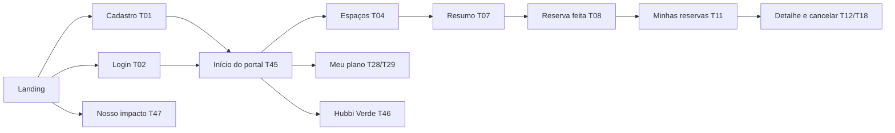

# PRD: Hubbi, MVP de reservas de espaços

| Campo | Valor |
|-------|-------|
| Produto | Hubbi: gestão de reservas de salas e espaços de coworking |
| Versão do documento | 1.0 (2026-10-10) |
| Fontes | [Constituição](.specify/memory/constitution.md) v1.0.0 · [Spec 001](specs/001-fluxos-reservas-hubbi/spec.md) · [Escopo social e ODS](specs/001-fluxos-reservas-hubbi/escopo-impacto-social-ods.md) |
| Documentos irmãos | [TRD](TRD.md) (requisitos técnicos) · [design.md](design.md) (design system) |
| Contexto | Disciplina de Engenharia de Software, Fatec Zona Sul. Empresa fictícia Hubbi |
| Equipe | [A PREENCHER: nomes e papéis dos 5 integrantes] |
| Professor orientador | Josenyr Santos Rocha |
| Data da apresentação | [A PREENCHER] |

> **Como ler este PRD.** As regras de negócio (RN), requisitos (FR), critérios de sucesso (SC),
> histórias (US), fluxos (F) e telas (T) já existem na spec 001 e não são repetidas aqui. Este
> documento só as **cita pelo código** (Constituição, princípio II) e define o que entra no MVP.
> Tudo que não foi decidido está marcado como **[A PREENCHER]** ou **[A DECIDIR]** e listado na
> seção 11.

## 1. Problema

Coworkings pequenos costumam controlar reservas por conversa, planilha ou caderno. Isso gera
três problemas que a spec 001 trata:

1. **Reservas sem controle:** conflito de horário, preço combinado na hora e cobrança sem
   registro (US1, US2).
2. **Espaço difícil de achar:** cada equipe precisa de algo diferente e não sabe o que cada
   sala oferece antes de chegar (US9).
3. **Acesso desigual:** estudantes, microempreendedores e organizações sem fins lucrativos ficam
   de fora de espaços pensados para quem tem verba (US8).

## 2. Proposta

Um site em que o cliente **encontra o espaço pelo que precisa, vê o preço final antes de
confirmar e cancela sabendo quanto volta**, com um plano social para quem tem menos acesso e
pontos que premiam o uso responsável do espaço.

## 3. Objetivos e não objetivos

### Objetivos do MVP

1. Demonstrar para a turma e o professor o fluxo completo do cliente, do cadastro ao
   cancelamento, funcionando no navegador.
2. Mostrar as regras centrais em ação: preço com desconto de plano (RN02), valor congelado
   (RN06), ciclo de vida da reserva (RN08) e cancelamento com multa e estorno visíveis antes de
   confirmar (RN07, RN11).
3. Mostrar o segmento social e sustentável funcionando: Plano Social (RN19), filtros por
   necessidade e acessibilidade (RN20), pontos verdes (RN22, RN23) e indicadores de impacto
   (RN21).
4. Funcionar em computador, tablet e celular (FR-021).

### Não objetivos

- Painel da equipe (recepção e administração). As ações da equipe são **simuladas** (seção 6.3).
- Pagamento online: o pagamento é sempre registrado pela equipe (Constituição, princípio IV).
- Tudo o que a Constituição exclui: controle de acesso físico, reservas recorrentes, eventos,
  comunidade, NPS, conectividade como métrica (princípio I).
- Mapa do andar para escolher o espaço (ver decisão D2).

## 4. Público

Os atores são os da spec 001 (seção **Atores**). No MVP, só o lado do **cliente** tem telas:

| Ator | No MVP |
|------|--------|
| Visitante | Vê a landing, os preços cheios, o simulador e a página de impacto; cria conta |
| Cliente avulso | Reserva pagando o valor cheio; a reserva nasce aguardando pagamento (RN12) |
| Membro | Reserva com desconto do plano; a reserva nasce confirmada (RN13) |
| Recepção e Administrador | Sem telas. Suas ações aparecem como simulação na barra do protótipo |

## 5. Escopo do MVP

### 5.1 Histórias de usuário

| História | Prioridade na spec | No MVP | Observação |
|----------|-------------------|--------|------------|
| US1 Cliente reserva um espaço | P1 | Sim | Fluxo principal |
| US2 Equipe gerencia reservas e pagamentos | P1 | Simulada | Sem telas da equipe; ações na barra do protótipo |
| US3 Cliente cancela uma reserva | P2 | Sim | Multa e estorno antes de confirmar |
| US4 Cadastro e acesso do cliente | P2 | Sim | Telas já prontas |
| US5 Administração de planos, espaços e preços | P2 | Não | Dados de exemplo fixos |
| US6 Contratar, trocar e encerrar plano | P3 | Sim | Contratar, trocar, cancelar a renovação e renovar perto do vencimento (D8, D9); ativação simulada |
| US7 Notificações e relatórios | P3 | Não | Relatórios da gestão (RN18) ficam fora |
| US8 Impacto social | P3 | Sim | Plano Social e página pública de impacto (decisão D5) |
| US9 Encontrar o espaço certo | P2 | Sim | Lista com filtros e atalhos |
| US10 Hubbi Verde | P3 | Sim | Pontos, extrato e resgate; ações da recepção simuladas |

### 5.2 Telas do MVP

Os códigos T vêm do [inventário de telas](specs/001-fluxos-reservas-hubbi/contracts/screen-inventory.md).
As telas novas recebem os próximos códigos livres, T46 e T47 (princípio V).

| Ordem | Tela | Código | Rota | Situação | Requisitos e regras |
|:-----:|------|--------|------|----------|---------------------|
| 1 | Landing page | sem código | `/` | Pronta | FR-003 (preços cheios), RN02, RN20 |
| 2 | Cadastro | T01 | `/signup` | Pronta | FR-001, FR-019, RN14, MSG-01 |
| 3 | Login | T02 | `/login` | Pronta | FR-002, RN17, MSG-02 |
| 3 | Recuperar senha | T03 | `/forgot-password` | Pronta | FR-002 |
| 4 | Início do portal | T45 | `/app` | Pronta | FR-003, RN13 |
| 5 | Espaços: busca e lista com filtros | T04 | `/app/spaces` | Pronta | FR-003, FR-004, FR-023, RN01–RN05, RN20 |
| 6 | Resumo da reserva | T07 | `/app/bookings/new` | Pronta | FR-004, FR-005, FR-025, FR-026, RN02–RN06, RN12, RN13, RN22, RN23 |
| 7 | Reserva feita (comprovante) | T08 | `/app/bookings/:id/confirmation` | Pronta | FR-004, RN06, RN09 |
| 8 | Minhas reservas | T11 | `/app/bookings` | Pronta | FR-006, FR-011, RN08, RN09 |
| 9 | Detalhe da reserva com cancelamento | T12 + T18 | `/app/bookings/:id` | Pronta | FR-005, FR-007, RN06–RN09, RN11 |
| 10 | Meu plano e solicitar plano (inclui Plano Social) | T28 + T29 | `/app/plan` | Pronta | FR-013, FR-022, RN13, RN19 |
| 11 | Hubbi Verde: saldo e extrato | T46 (nova) | `/app/rewards` | Pronta | FR-025, RN22, RN23 |
| 12 | Nosso impacto (página pública) | T47 (nova) | `/impact` | Pronta | FR-024, RN21 |

**Rotas em inglês (decisão D7).** Os endereços da URL usam inglês, no padrão de mercado
(`/login`, `/signup`, `/forgot-password`, área logada em `/app`). Todo o texto que a pessoa lê na
tela continua em português do Brasil. As rotas e os parâmetros estão detalhados no
[TRD](TRD.md), seção 4.

Telas do inventário que **não** entram no MVP: T05 (detalhe do espaço; as informações ficam no
cartão de T04), T06, T09, T10, T13 a T17, T19 a T27, T30 a T44.

### 5.3 Fluxo da apresentação

O caminho principal, para mostrar em sala, usa as telas 1 a 9. As telas 10 a 12 mostram o
segmento social e sustentável.

### 5.4 Fluxos do MVP

O MVP é construído por fluxo, uma tela por vez.

| # | Fluxo | Telas | Regras principais | Situação |
|---|-------|-------|-------------------|----------|
| 1 | Acesso | Landing, T01, T02, T03 | FR-001, FR-002, RN14, RN17 | Fechado |
| 2 | Reserva | T45, T04, T07, T08 | RN01–RN06, RN12, RN13, RN20, RN22, RN23 | Fechado |
| 3 | Minhas reservas e cancelamento | T11, T12 + T18 | RN07, RN08, RN09, RN11 | Fechado |
| 4 | Planos e Plano Social | T28 + T29 | RN13, RN19 | Fechado |
| 5 | Hubbi Verde | T46 | RN22, RN23 | Fechado |
| 6 | Nosso impacto | T47 | RN21 | Fechado |

As ações simuladas da recepção (seção 6.3) entram junto com o fluxo que as usa: registrar
pagamento, concluir reserva, não comparecimento e expirar no fluxo 3; validar Plano Social no
fluxo 4; confirmar chegada limpa no fluxo 5.

## 6. Requisitos do MVP

### 6.1 Funcionais

Valem os FR da spec 001 citados na tabela 5.2. Nenhum requisito funcional novo é criado por este
PRD.

### 6.2 Não funcionais

| Requisito | Fonte | Como o MVP atende |
|-----------|-------|-------------------|
| Responsivo em computador, tablet e celular | FR-021, Constituição | Testado de 360 a 1920 px ([TRD](TRD.md), seção 7) |
| Resposta em até 2 s nas operações comuns | FR-021, SC-009 | Sem servidor: as operações rodam no navegador |
| Senha só como hash | FR-019, princípio VI | Ver [TRD](TRD.md), seção 5 |
| Cada cliente vê só os próprios dados | RN17, SC-008 | Cada conta vê só as próprias reservas |
| Mensagens claras, sem dados sensíveis | FR-018 | Textos do [ui-messages](specs/001-fluxos-reservas-hubbi/contracts/ui-messages.md) |
| Acessibilidade WCAG 2.2 AA | plan.md | Regras no [design.md](design.md) |

### 6.3 Ações da equipe simuladas

Como o MVP não tem telas da equipe (decisão D4), a barra **Estados do protótipo** oferece as
ações que, pela spec, são da recepção. O cliente vê o efeito na hora.

| Ação simulada | Regra | Efeito que o cliente vê |
|---------------|-------|-------------------------|
| Registrar pagamento | RN12 | Reserva passa de "Aguardando pagamento" para "Confirmada" |
| Concluir reserva | RN08, RN10, RN22 | Reserva "Concluída" e +10 pontos, com bônus de sequência |
| Confirmar chegada limpa | RN23 | +5 pontos, no máximo uma vez por dia |
| Marcar não comparecimento | RN08, RN10, RN22 | Reserva "Não compareceu"; sequência de bônus reinicia |
| Gerência aprova ou recusa o Plano Social | RN19 | Pedido segue para pagamento, ou fica recusado com o motivo |
| Recepção registra pagamento do plano | RN13 | Plano ativo (ou troca e renovação agendadas para o vencimento) |
| Simular plano perto do vencimento | RN13, RN16 | Aparece o aviso e o botão "Renovar plano" |
| Expirar reserva sem pagamento | RN12 | Reserva "Cancelada" sem multa e horário liberado |
| Simular: faltam 5 h ou 90 min para o início | RN07 | O início da reserva se aproxima, para mostrar a multa de 50% ou de 100% no cancelamento |

## 7. Critérios de sucesso

Os critérios da spec 001 que o MVP precisa demonstrar:

| Critério | O que mostrar |
|----------|---------------|
| SC-001 | Reservar do login ao resumo final em até 3 minutos |
| SC-002 | Horário ocupado, fora do funcionamento ou com duração inválida é recusado com o motivo |
| SC-003 | Preço = preço/hora × duração × (1 − desconto); membro paga menos que avulso |
| SC-004 | Só transições permitidas do ciclo de vida |
| SC-005 | Multa e estorno aparecem antes de confirmar o cancelamento |
| SC-008 | Nenhum cliente vê dados de outro |
| SC-010 | Indicadores de impacto batem com as reservas registradas |
| SC-011 | Filtros mostram só espaços que atendem a todos os critérios |
| SC-012 | Saldo de pontos = soma do extrato; abatimento até 10% |

Teste de usabilidade com 5 pessoas (SC-007): [A DECIDIR se será feito antes da apresentação].

## 8. Premissas e dependências

- Os dados (espaços, preços, planos, valores de multa e de pontos) são os **exemplos ajustáveis**
  da spec 001 (seção Assumptions e [data-model](specs/001-fluxos-reservas-hubbi/data-model.md)).
- Os dados ficam salvos no navegador de quem usa (decisão D3). Cada computador tem os próprios
  dados.
- O site é publicado na Vercel ([TRD](TRD.md), seção 8).

## 9. Riscos

| Risco | Impacto | Mitigação |
|-------|---------|-----------|
| Dados presos a um navegador | Uma reserva feita num computador não aparece em outro | Botão de protótipo para restaurar os dados de exemplo; demonstrar sempre no mesmo computador |
| Ações da equipe simuladas | Pode parecer que o cliente aprova o próprio plano | Barra identificada como "Estados do protótipo", com ações nomeadas "Recepção …" |
| Página de impacto pública diverge da spec, que pensa o relatório para a gestão (RN21) | Inconsistência no documento | Registrar a divergência no quadro de versões (decisão D5) |
| Escopo de 9 telas novas | Atraso | Ordem de construção da tabela 5.2; telas 10 a 12 por último |

## 10. Decisões registradas

| ID | Data | Decisão | Quem decidiu |
|----|------|---------|--------------|
| D1 | 2026-10-10 | Fluxo do MVP: reservar e cancelar, só perfil Cliente | Responsável pelo projeto |
| D2 | 2026-10-10 | Escolha do espaço por lista com filtros; mapa do andar fica para depois (avaliação `mapa-selecao-espacos` segue "precisa de esclarecimento") | Responsável pelo projeto |
| D3 | 2026-10-10 | Dados salvos no navegador, sem servidor | Responsável pelo projeto |
| D4 | 2026-10-10 | Segmento social e Hubbi Verde completos no MVP; ações da equipe simuladas na barra do protótipo | Responsável pelo projeto |
| D5 | 2026-10-10 | Relatório de impacto como página pública "Nosso impacto" | Responsável pelo projeto |
| D6 | 2026-10-10 | Na apresentação, mostrar o site; a tecnologia não é tema | Responsável pelo projeto |
| D8 | 2026-10-11 | Meu plano no MVP: contratar, trocar (vale no vencimento) e cancelar (só impede a renovação), como na T28 | Responsável pelo projeto |
| D9 | 2026-10-11 | Renovação no MVP: botão "Renovar plano" quando faltarem 5 dias ou menos; a recepção efetiva ao registrar o pagamento | Responsável pelo projeto |
| D10 | 2026-10-11 | Plano Social: a pessoa informa a categoria e uma observação opcional e curta (até 140 caracteres); a **gerência** analisa o pedido antes do pagamento. Muda a RN19, que hoje grava só categoria, data e responsável: pendente de revisor | Responsável pelo projeto |
| D11 | 2026-10-11 | Cálculo dos indicadores de Nosso impacto: horas reservadas = reservas que seguraram o espaço (não canceladas); capacidade perdida = faltas, reservas expiradas e cancelamentos com multa sobre as horas que ocuparam ou seguraram o espaço; ocupação = horas reservadas ÷ horas de funcionamento no período. A RN21 não define denominadores: pendente de revisor | Proposta da IA, a confirmar |
| D7 | 2026-10-10 | Rotas da URL em inglês, no padrão de mercado (`/login`, `/signup`, `/app/...`); interface em português | Responsável pelo projeto (padrão escolhido pela IA a pedido) |

## 11. Pendências

| # | Pendência | Onde |
|---|-----------|------|
| 1 | Nomes e papéis dos 5 integrantes | Cabeçalho |
| 2 | Data da apresentação | Cabeçalho |
| 3 | ~~Troca e cancelamento de plano entram no MVP?~~ Resolvido em D8 e D9 | 5.1, US6 |
| 4 | Teste de usabilidade com 5 pessoas antes da apresentação? | Seção 7 |
| 5 | Percentual e preço do Plano Social (hoje exemplos: 30%, R$ 60,00) | Spec, RN19 |
| 6 | Valores de pontos (10, 20, 5; 100 pontos = 10%) | Spec, RN22 |
| 7 | Cores semânticas (sucesso, alerta, erro) ainda "a aprovar" na pesquisa | [design.md](design.md) |
| 8 | Fonte oficial da marca e logo em vetor | [design.md](design.md) |
| 9 | "CPF ou CNPJ" no cadastro, ou só CPF | T01 |
| 10 | Revisor das versões 0.4 a 0.6 da spec (mudam regras) | Quadro de versões |
