# Hubbi: Briefing de Design Completo (Spec 001)

> Documento único para o agente de design (Figma AI ou Claude Design). Reúne a especificação, os
> fluxos, o plano, o design system, o inventário de telas, os textos e os cenários de verificação.
> Referências entre arquivos viraram menções por nome de parte. Códigos RN, FR, SC, F e T são
> estáveis e devem ser citados nas telas do protótipo.

**Imagens da marca** (paleta "Opção C Pervinca" e conceito do símbolo): enviar junto com este
arquivo; ver Parte 6. **Decisões abertas** (plataforma, cores semânticas, fonte, vetores da marca,
lacunas da spec): ver Parte 3.

## Sumário

1. Parte 1. Especificação (atores, histórias, regras e requisitos)
2. Parte 2. Fluxos F01 a F12 (diagramas Mermaid)
3. Parte 3. Plano do briefing de design
4. Parte 4. Decisões de design e contraste
5. Parte 5. Conteúdo e estados que a interface exibe
6. Parte 6. Design system
7. Parte 7. Inventário de telas
8. Parte 8. Textos e regras visíveis na interface
9. Parte 9. Verificação do protótipo
10. Parte 10. Versionamento


---

# Parte 1. Especificação (atores, histórias, regras e requisitos)

**Feature Branch**: `001-fluxos-reservas-hubbi` (sem branch git; pasta de spec apenas)

**Created**: 2026-10-05

**Status**: Draft

**Input**: User description: "Especificação dos fluxos e do funcionamento da aplicação Hubbi (sistema de gerenciamento de salas/espaços para coworking), para servir de base ao protótipo no Figma/FigJam: fluxos de usuário (equipe e membro/avulso com portal próprio), reservas com ciclo de vida, duração e horário de funcionamento, cancelamento com multa/estorno, preço por espaço/hora com desconto por plano, pagamentos manuais, cadastros, disponibilidade, relatórios, notificações, perfis e permissões."

> **Natureza deste documento**: esta spec descreve **como a aplicação funciona** (fluxos, estados e
> regras) e não uma funcionalidade isolada. Ela é a fonte para o protótipo no Figma e os fluxos no
> FigJam. Os códigos RN, FR e fluxos (F01…) são estáveis e devem ser citados pelo protótipo
> (Constituição, princípio V).

### Clarifications

#### Session 2026-10-06

- Q: Membro cancela reserva confirmada sem pagamento dentro da faixa de multa: a multa é cobrada? → A: Sim. Gera cobrança de multa *pendente* (50% ou 100%) e cancela a cobrança original da reserva; a equipe registra o pagamento da multa depois.
- Q: Pagamento parcial menor que a multa no cancelamento: o que acontece com a diferença? → A: O valor pago é retido como multa e o saldo vira cobrança de multa *pendente*; estorno = 0.
- Q: Qual a antecedência mínima de reserva e o que ocorre com avulso reservando com menos de 1h de antecedência? → A: Mínimo de 1h para o cliente no portal; a recepção pode reservar com menos e registrar o pagamento na hora, e a reserva já nasce *confirmada*.
- Q: Membro com cobrança vencida não paga pode reservar? → A: Pode, mas a nova reserva é tratada como avulso: nasce *pendente* e **sem** desconto do plano (preço cheio) enquanto houver cobrança vencida.
- Q: Plano cancelado, trocado ou encerrado no meio da vigência tem devolução do valor pago? → A: Não. O plano vale até o vencimento já pago; cancelar só impede a renovação e trocar passa a valer no próximo vencimento.
- Q: O cliente contrata e troca o próprio plano pelo portal ou só a recepção? → A: O cliente *solicita* contratação, troca e cancelamento no portal (gera assinatura e cobrança pendentes); a equipe efetiva ao registrar o pagamento.
- Q: O cadastro do cliente exige documento? → A: Sim. Documento obrigatório já no cadastro do portal; unicidade por e-mail e por documento.
- Q: Qual o preço do plano e como é cobrado? → A: Preço fixo e duração em dias (ex.: mensal = 30 dias), definidos pelo administrador; a cobrança é gerada na contratação e a cada renovação solicitada.
- Q: Política de dados pessoais quando o cliente pede exclusão da conta? → A: Anonimização dos dados pessoais (nome, e-mail, documento, telefone), mantendo reservas e pagamentos ligados a um cadastro anônimo; só a equipe executa, com registro de quem fez.
- Q: Metas de desempenho e dispositivos? → A: Adotar a meta da constituição: operações comuns em até 2 s em condições normais; protótipo cobre computador, tablet e celular em todos os fluxos F01–F12.

### Atores

- **Visitante**: pessoa sem login. Pode se cadastrar e ver espaços e preços cheios.
- **Cliente avulso**: cadastrado, sem plano ativo. Reserva pagando o valor cheio.
- **Membro**: cadastrado, com plano ativo. Reserva com desconto do plano.
- **Recepção**: equipe que opera o dia a dia (cadastros, reservas em nome de clientes, pagamentos).
- **Administrador**: equipe com acesso total (espaços, preços, planos, relatórios, usuários da equipe).

> Avulso e Membro são o mesmo perfil de portal (Cliente). A diferença é só ter ou não plano ativo.

### User Scenarios & Testing *(mandatory)*

#### User Story 1 - Cliente reserva um espaço (Priority: P1)

O cliente (avulso ou membro) consulta a disponibilidade de um espaço, escolhe data e horário,
vê o preço calculado e finaliza a reserva pelo portal.

**Why this priority**: é o coração do Hubbi. Sem reserva sem conflito e com preço correto, o
sistema não entrega valor.

**Independent Test**: com um espaço ativo e preço cadastrados, um cliente consegue reservar um
horário livre e ver o valor correto; o mesmo horário deixa de aparecer como livre.

**Acceptance Scenarios**:

1. **Given** um espaço ativo com horário livre, **When** o cliente escolhe data, início e duração
   válidos, **Then** o sistema mostra o preço (cheio para avulso, com desconto para membro) antes
   de confirmar e cria a reserva (RN01, RN02, RN06).
2. **Given** um horário já ocupado por reserva ativa, **When** o cliente tenta reservá-lo,
   **Then** o sistema impede e sugere horários livres do mesmo espaço (RN03).
3. **Given** uma duração menor que a mínima, maior que a máxima ou fora do horário de
   funcionamento, **When** o cliente tenta reservar, **Then** o sistema recusa com mensagem clara
   dizendo qual limite foi violado (RN04, RN05).
4. **Given** um cliente avulso, **When** a reserva é criada, **Then** ela fica *pendente* até a
   equipe registrar o pagamento (RN12).
5. **Given** um membro com plano ativo, **When** a reserva é criada, **Then** ela fica
   *confirmada* na hora e uma cobrança pendente é gerada (RN13).


#### User Story 2 - Equipe gerencia reservas e registra pagamentos (Priority: P1)

A recepção reserva em nome de um cliente, registra o pagamento, marca presença ou no-show e
conclui reservas.

**Why this priority**: sem a equipe confirmando pagamentos e fechando reservas, o ciclo de vida
não anda e o histórico fica incorreto.

**Independent Test**: a recepção cria uma reserva avulsa, registra o pagamento, a reserva vira
*confirmada*; depois do horário marca como *concluída*.

**Acceptance Scenarios**:

1. **Given** uma reserva *pendente* de cliente avulso, **When** a recepção registra o pagamento
   total, **Then** o pagamento fica *realizado* e a reserva passa a *confirmada* (RN12).
2. **Given** uma reserva *confirmada* cujo horário passou, **When** a recepção marca presença,
   **Then** a reserva fica *concluída*; se marca ausência, fica *no-show* (RN08, RN10).
3. **Given** uma reserva *pendente* sem pagamento após o prazo de expiração, **When** o prazo
   vence, **Then** a reserva é cancelada automaticamente e o horário volta a ficar livre (RN12).
4. **Given** qualquer reserva, **When** ela muda de estado, **Then** a mudança fica registrada no
   histórico com data, hora e quem fez (RN09).


#### User Story 3 - Cliente cancela uma reserva (Priority: P2)

O cliente cancela uma reserva respeitando o prazo de cancelamento. O sistema mostra a multa ou o
estorno **antes** de ele confirmar.

**Why this priority**: o cancelamento afeta dinheiro e liberação de horários, mas só ocorre
depois que as reservas existem.

**Independent Test**: cancelar reservas em três faixas de prazo e conferir multa e estorno
mostrados.

**Acceptance Scenarios**:

1. **Given** uma reserva confirmada com início bem distante, **When** o cliente cancela dentro do
   prazo gratuito, **Then** não há multa, o valor é estornado integralmente e o horário é liberado
   (RN07, RN11).
2. **Given** um cancelamento fora do prazo gratuito, **When** o cliente confirma, **Then** o
   sistema mostra e aplica a multa conforme a faixa e estorna o restante (RN07).
3. **Given** uma reserva já concluída, cancelada ou no-show, **When** o cliente tenta cancelá-la,
   **Then** o sistema não permite (RN08).


#### User Story 4 - Cadastro e acesso do cliente (Priority: P2)

O visitante cria sua conta e passa a ser cliente avulso; pode contratar um plano para virar membro.
A recepção também pode cadastrar e editar clientes.

**Why this priority**: sem cadastro não há reserva; porém um cadastro mínimo já permite os fluxos
P1.

**Independent Test**: um visitante cria conta, entra no portal, vê só as próprias reservas e dados.

**Acceptance Scenarios**:

1. **Given** um visitante, **When** envia nome, e-mail, documento, telefone e senha válidos, **Then** cria o
   cadastro único como cliente avulso (RN14).
2. **Given** um e-mail ou documento já cadastrado, **When** o visitante tenta se registrar, **Then** o sistema
   recusa e orienta a entrar ou recuperar a senha (RN14).
3. **Given** um cliente logado, **When** acessa o portal, **Then** vê apenas os próprios dados,
   reservas e pagamentos (RN17).
4. **Given** um cliente com histórico, **When** a equipe "exclui" o cadastro, **Then** ele é
   inativado e o histórico permanece (RN09, RN15).


#### User Story 5 - Administração de planos, espaços e preços (Priority: P2)

O administrador cadastra espaços (salas, mesas, estações), define preço por hora, horário de
funcionamento, limites de duração e planos com desconto percentual.

**Why this priority**: alimenta todos os outros fluxos, mas pode começar com poucos dados fixos.

**Independent Test**: criar um espaço, um preço e um plano, e conferir o preço calculado para
avulso e membro.

**Acceptance Scenarios**:

1. **Given** o administrador, **When** cadastra um espaço com tipo, capacidade e preço/hora,
   **Then** o espaço fica disponível para reserva (RN01).
2. **Given** um plano com desconto de 20%, **When** um membro reserva, **Then** o preço = preço
   cheio × (1 − 20%) (RN02).
3. **Given** uma mudança de preço ou desconto, **When** ela é salva, **Then** reservas já criadas
   mantêm o valor original gravado (RN06).
4. **Given** um espaço com reservas futuras, **When** o administrador tenta inativá-lo, **Then** o
   sistema avisa e exige tratar essas reservas antes (RN15).


#### User Story 6 - Contratar, trocar e encerrar plano (Priority: P3)

Cliente contrata um plano (vira membro), a equipe registra o pagamento do plano, e o plano pode
vencer, ser trocado ou cancelado.

**Why this priority**: gera receita recorrente, mas o sistema funciona antes com todos como avulsos.

**Independent Test**: contratar plano, registrar o pagamento e ver o desconto aplicado na próxima
reserva; deixar vencer e ver o preço voltar ao cheio.

**Acceptance Scenarios**:

1. **Given** um cliente avulso, **When** contrata um plano e a equipe registra o pagamento,
   **Then** o plano fica ativo e passa a dar desconto nas novas reservas (RN13).
2. **Given** um plano vencido, **When** o cliente reserva, **Then** ele é tratado como avulso
   (RN13).
3. **Given** um plano que vence, **When** faltam poucos dias, **Then** o cliente recebe aviso
   (RN16).


#### User Story 7 - Notificações e relatórios (Priority: P3)

O cliente recebe avisos sobre suas reservas e pagamentos. A equipe consulta relatórios de
reservas, clientes e pagamentos.

**Why this priority**: melhora a operação e a gestão, mas não bloqueia o ciclo principal.

**Independent Test**: criar, cancelar e pagar reservas e conferir avisos e relatórios.

**Acceptance Scenarios**:

1. **Given** uma reserva criada, confirmada, cancelada ou prestes a começar, **When** o evento
   ocorre, **Then** o cliente é avisado (RN16).
2. **Given** um período escolhido, **When** a equipe gera um relatório, **Then** vê reservas por
   estado, receita por pagamentos realizados, multas, ocupação por espaço e clientes por tipo
   (RN18).


#### Edge Cases

- Duas pessoas tentam reservar o mesmo horário quase ao mesmo tempo: só uma reserva é criada; a
  outra recebe aviso de conflito (RN03).
- Reserva que cruza o fim do horário de funcionamento ou a virada de dia: recusada (RN04).
- Cliente ganha ou perde plano entre criar a reserva e o uso: o preço da reserva não muda (RN06).
- Cancelamento de reserva ainda *pendente* sem pagamento: sem multa e sem estorno (RN07).
- Estorno de reserva cujo pagamento ainda não foi registrado: não há estorno a fazer; se houver
  multa, ela vira cobrança pendente (RN07).
- Cliente inativado com reservas futuras: reservas futuras são tratadas antes da inativação (RN15).
- Espaço inativado: some da busca, mas continua nos históricos e relatórios (RN15).
- Registro de pagamento em valor diferente do devido: recusado ou marcado como parcial com
  justificativa (RN12).
- Tentativa de acessar dados de outro cliente: negada (RN17).
- Marcar no-show antes do horário de término: não permitido (RN10).

### Requirements *(mandatory)*

#### Fluxos que o protótipo MUST cobrir (FigJam/Figma)

| Código | Fluxo | Ator(es) | Histórias |
|--------|-------|----------|-----------|
| F01 | Cadastro e login | Visitante, Cliente | US4 |
| F02 | Consultar disponibilidade e preço | Cliente, Recepção | US1 |
| F03 | Criar reserva (caminho feliz + erros de conflito, duração e horário) | Cliente, Recepção | US1 |
| F04 | Pagar e confirmar reserva (registro manual) | Recepção | US2 |
| F05 | Cancelar reserva (com simulação de multa/estorno) | Cliente, Recepção | US3 |
| F06 | Encerrar reserva (concluir ou no-show) | Recepção | US2 |
| F07 | Gerir espaços, preços e horários | Administrador | US5 |
| F08 | Gerir planos e contratar/trocar/encerrar plano | Administrador, Recepção, Cliente | US5, US6 |
| F09 | Gerir clientes (cadastrar, editar, inativar, consultar) | Recepção | US4 |
| F10 | Notificações recebidas | Cliente | US7 |
| F11 | Relatórios | Recepção, Administrador | US7 |
| F12 | Gerir usuários da equipe e permissões | Administrador | US7 |

#### Regras de Negócio

- **RN01 — Espaço reservável**: só espaços ativos, com preço/hora e horário definidos, podem ser
  reservados.
- **RN02 — Preço da reserva**: preço = preço/hora do espaço × duração em horas × (1 − desconto do
  plano ativo do cliente). Cliente avulso (sem plano ativo) tem desconto 0%.
- **RN03 — Sem sobreposição**: um espaço não pode ter duas reservas ativas (pendente ou
  confirmada) em períodos que se sobreponham. Término de uma e início de outra no mesmo instante
  não é sobreposição.
- **RN04 — Horário de funcionamento**: a reserva inteira (início e fim) deve estar dentro do
  horário de funcionamento do dia, no mesmo dia.
- **RN05 — Duração**: a duração deve respeitar o mínimo e o máximo definidos e ser múltipla do
  passo de agendamento.
- **RN06 — Valor congelado**: valor cheio, desconto aplicado, plano vigente e valor final são
  gravados na reserva ao criá-la e não mudam depois.
- **RN07 — Política de cancelamento**: cancelar ≥ 24h antes do início: sem multa. Entre 24h e 2h
  antes: multa de 50% do valor. Menos de 2h antes: multa de 100%. O valor da multa é calculado e
  mostrado antes de o cliente confirmar. Cancelamento de reserva pendente sem pagamento: sem multa.
  Reserva *confirmada* ainda sem pagamento (caso do membro, RN13) segue a mesma tabela de multa:
  a cobrança original da reserva é cancelada e gera-se uma cobrança de multa *pendente* (50% ou
  100% do valor), que a equipe registra depois. Sem multa na faixa gratuita, apenas cancela a
  cobrança original. Se o valor já pago (pagamento parcial) for menor que a multa, o pago é
  retido como multa, o saldo vira cobrança de multa *pendente* e o estorno é 0.
- **RN08 — Ciclo de vida**: estados *pendente*, *confirmada*, *concluída*, *cancelada*, *no-show*.
  Transições permitidas apenas: pendente→confirmada, pendente→cancelada, confirmada→cancelada,
  confirmada→concluída, confirmada→no-show. *Concluída*, *cancelada* e *no-show* são finais.
- **RN09 — Histórico imutável**: reservas e mudanças de estado nunca são apagadas; cada mudança
  registra data/hora e responsável.
- **RN10 — Encerramento**: *concluída* e *no-show* só podem ser marcadas pela equipe, depois do
  término da reserva.
- **RN11 — Estorno**: o valor pago menos a multa é devolvido; o estorno é registrado pela equipe
  como pagamento *estornado*.
- **RN12 — Reserva avulsa e pagamento**: reserva de cliente avulso nasce *pendente* e vira
  *confirmada* quando a equipe registra o pagamento integral; se não houver pagamento em até 2h
  (ou até 1h antes do início, o que ocorrer primeiro), ela expira e vira *cancelada* sem multa.
  No portal, o cliente só reserva com no mínimo 1h de antecedência do início; a recepção pode
  reservar com menos que isso, registrando o pagamento integral no ato (a reserva já nasce
  *confirmada*).
  Todo pagamento tem situação: pendente, realizado ou estornado, e liga-se a um cliente e a uma
  reserva ou a um plano.
- **RN13 — Reserva de membro**: reserva de membro com plano ativo nasce *confirmada* e gera uma
  cobrança *pendente* para a equipe registrar depois. Plano vencido ou cancelado equivale a avulso.
  O mesmo vale para o membro com cobrança vencida (cobrança pendente de reserva já concluída ou
  *no-show*, ou multa pendente): enquanto ela existir, a nova reserva é tratada como avulso,
  nasce *pendente* e sem desconto do plano (RN02 com desconto 0%). Ao quitar, volta ao
  tratamento de membro nas reservas seguintes.
  Cancelar, trocar ou encerrar um plano não gera devolução do valor pago: o plano segue ativo
  até o vencimento já pago; cancelar apenas impede a renovação e a troca passa a valer no
  próximo vencimento.
- **RN14 — Cadastro único**: um cadastro por e-mail e por documento do cliente.
- **RN15 — Exclusão lógica**: clientes, espaços e planos com histórico são inativados, nunca
  apagados. Inativar um cliente ou espaço exige resolver antes as reservas futuras.
  A pedido do titular (LGPD), a equipe anonimiza os dados pessoais do cliente (nome, e-mail,
  documento, telefone): o cadastro vira anônimo e inativo, reservas e pagamentos permanecem
  ligados a ele, e a ação registra data, hora e responsável (RN09). Por inativar o cadastro, a
  anonimização também exige resolver antes as reservas futuras.
- **RN16 — Notificações**: o cliente é avisado ao criar, confirmar, cancelar (com multa/estorno),
  expirar uma reserva, antes do início (lembrete) e antes do vencimento do plano.
- **RN17 — Permissões**: cliente só vê e altera seus próprios dados. Recepção opera cadastros,
  reservas e pagamentos. Administrador faz tudo, incluindo espaços, preços, planos e equipe.
  Alterar ou excluir cadastros de clientes só por equipe autorizada. O cliente também solicita
  contratação, troca e cancelamento do próprio plano, e cancela as próprias reservas; a
  efetivação do plano é sempre da equipe.
- **RN18 — Relatórios**: usam apenas dados registrados; receita conta somente pagamentos
  *realizados*, menos estornos.

#### Functional Requirements

- **FR-001**: O sistema MUST permitir que visitantes criem conta como cliente avulso (RN14).
- **FR-002**: O sistema MUST autenticar clientes e equipe antes de qualquer acesso a dados
  pessoais (RN17).
- **FR-003**: O sistema MUST permitir consultar a disponibilidade de espaços por data, horário e
  tipo, mostrando preço calculado conforme o tipo do cliente (RN02, RN06).
- **FR-004**: O sistema MUST criar reservas validando conflito, horário de funcionamento e
  duração (RN03, RN04, RN05).
- **FR-005**: O sistema MUST gravar valor cheio, desconto e valor final na reserva (RN06).
- **FR-006**: O sistema MUST aplicar o ciclo de vida da reserva e recusar transições inválidas
  (RN08).
- **FR-007**: O sistema MUST permitir que cliente e equipe cancelem reservas, mostrando
  multa/estorno antes da confirmação (RN07, RN11).
- **FR-008**: O sistema MUST expirar automaticamente reservas pendentes sem pagamento (RN12).
- **FR-009**: A equipe MUST poder registrar pagamentos, parciais ou totais, e estornos, e
  consultar pagamentos pendentes e realizados (RN11, RN12).
- **FR-010**: A equipe MUST poder marcar reservas como concluídas ou no-show após o término
  (RN10).
- **FR-011**: O sistema MUST manter o histórico de reservas e de mudanças de estado (RN09).
- **FR-012**: O administrador MUST poder cadastrar espaços, preços/hora, horário de
  funcionamento e limites de duração (RN01, RN04, RN05).
- **FR-013**: O administrador MUST poder cadastrar planos com desconto percentual e a equipe
  MUST poder associar, trocar e encerrar o plano de um cliente (RN13). O cliente MUST poder
  solicitar contratação, troca e cancelamento do próprio plano no portal; a solicitação só
  produz efeito quando a equipe registra o pagamento ou a efetiva (RN13, RN17).
- **FR-014**: A equipe MUST poder cadastrar, editar, consultar e inativar clientes (RN15, RN17).
- **FR-015**: O sistema MUST enviar as notificações da RN16.
- **FR-016**: O sistema MUST gerar relatórios de reservas, clientes, pagamentos e ocupação por
  período (RN18).
- **FR-017**: O sistema MUST aplicar permissões por perfil: Cliente, Recepção, Administrador
  (RN17).
- **FR-018**: O sistema MUST mostrar mensagens de erro claras sem expor dados sensíveis.
- **FR-019**: O sistema MUST armazenar senhas apenas como hash e coletar só os dados pessoais
  necessários (LGPD), e MUST permitir à equipe anonimizar os dados de um cliente a pedido do
  titular (RN15).
- **FR-020**: Cada tela e fluxo do protótipo MUST citar os FR e RN que realiza e cobrir caminho
  feliz e principais erros.
- **FR-021** (não funcional): O sistema MUST responder às operações comuns em até 2 segundos em
  condições normais e a interface MUST ser responsiva para computador, tablet e celular; o
  protótipo MUST apresentar os fluxos F01–F12 nas três telas.

#### Key Entities

- **Cliente**: pessoa cadastrada (nome, e-mail, documento, telefone, estado ativo/inativo).
  Tem zero ou um plano ativo.
- **Plano**: oferta com nome, desconto percentual, preço fixo, duração em dias e situação. A
  cobrança do plano é gerada na contratação e a cada renovação solicitada pelo cliente.
- **Assinatura**: ligação entre Cliente e Plano, com início, vencimento e situação.
- **Espaço**: sala, mesa ou estação com tipo, capacidade, preço/hora, horário de funcionamento e
  estado ativo/inativo.
- **Reserva**: Cliente + Espaço + período, estado, valor cheio, desconto, valor final.
- **Histórico de Reserva**: cada mudança de estado, com data/hora e responsável.
- **Pagamento/Cobrança**: valor, situação (pendente, realizado, estornado), ligado a Cliente e a
  Reserva ou Assinatura; inclui multas e estornos.
- **Notificação**: aviso enviado ao cliente com tipo, conteúdo e data.
- **Usuário da Equipe**: Recepção ou Administrador, com permissões.

### Success Criteria *(mandatory)*

#### Measurable Outcomes

- **SC-001**: Um cliente consegue reservar um espaço, do login ao resumo final, em até 3 minutos
  no protótipo.
- **SC-002**: 100% das tentativas de reserva sobrepostas, fora do horário ou com duração inválida
  são recusadas com mensagem que indica o motivo.
- **SC-003**: Em 100% dos casos de teste, o preço mostrado = preço/hora × duração × (1 − desconto)
  e o membro paga menos que o avulso para a mesma reserva.
- **SC-004**: Cada reserva só percorre transições permitidas; 100% das tentativas inválidas são
  recusadas.
- **SC-005**: O cliente vê a multa ou estorno antes de confirmar o cancelamento em 100% dos
  casos.
- **SC-006**: Todos os 12 fluxos (F01–F12) estão desenhados no FigJam e prototipados no Figma,
  cada um citando seus FR e RN.
- **SC-007**: Em teste de usabilidade com pelo menos 5 pessoas, 80% concluem reservar e cancelar
  sem ajuda.
- **SC-008**: Nenhum cliente consegue ver dados de outro cliente em qualquer fluxo do protótipo.
- **SC-009**: Em 100% das operações comuns, a resposta ocorre em até 2 segundos em condições
  normais, e os fluxos F01–F12 estão apresentados em computador, tablet e celular (FR-021).

### Assumptions

- Esta é a **v1** e o entregável é documento + protótipo (Figma/FigJam); stack tecnológica fica
  para o plano.
- Os valores numéricos de regras são **padrões ajustáveis**: horário de funcionamento 07h–22h de
  segunda a sábado; passo de agendamento 30 min; duração mínima 1h e máxima 8h; prazos e multas
  da RN07; expiração de pendente da RN12. A equipe pode alterá-los sem mudar a estrutura das
  regras.
- Os descontos de plano são exemplos (ex.: 10%, 20%, 30%) e são definidos pelo administrador.
- Pagamento é sempre registrado manualmente pela equipe; não há gateway, cartão ou Pix
  integrado.
- Notificações são exibidas no portal e enviadas por e-mail; outros canais (SMS, WhatsApp) ficam
  fora da v1.
- Fora do escopo: controle de acesso físico, reservas recorrentes, eventos, comunidade/networking,
  e métricas do negócio físico (NPS, conectividade).
- Um cliente tem no máximo um plano ativo por vez.
- Reservas são por horário em um único espaço; combos de vários espaços ficam fora da v1.
- Mesas hot-desk podem ser tratadas como espaços de capacidade 1 e reservadas como qualquer outro.

---

# Parte 2. Fluxos F01 a F12 (diagramas Mermaid)

Diagramas dos fluxos F01 a F12 da spec. Cada diagrama cita as regras (RN) e os
requisitos (FR) que realiza, conforme o princípio V da constituição. Valores como horário, multas
e prazos são os padrões da spec.

Legenda: retângulo = ação; losango = decisão; arredondado = início ou fim; paralelogramo-texto
`[/ /]` = tela ou mensagem ao usuário.


### Ciclo de vida da reserva (RN08, RN09, FR-006)

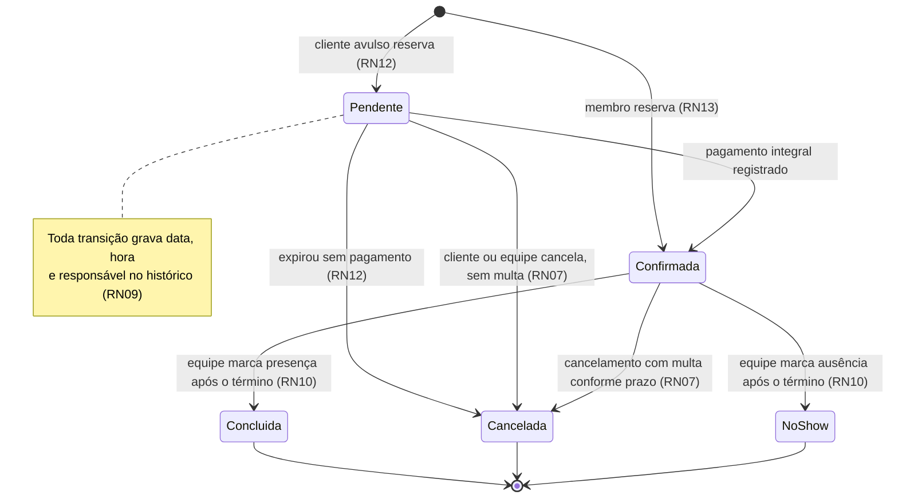


### F01 — Cadastro e login (US4, RN14, RN17, FR-001, FR-002, FR-019)

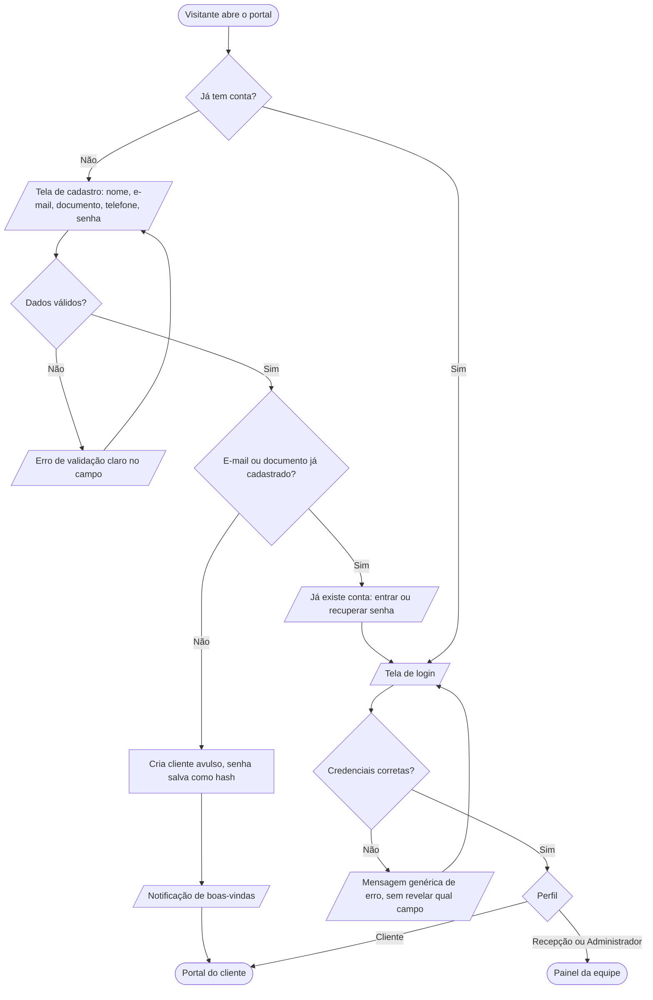


### F02 — Consultar disponibilidade e preço (US1, RN01, RN02, RN06, FR-003)

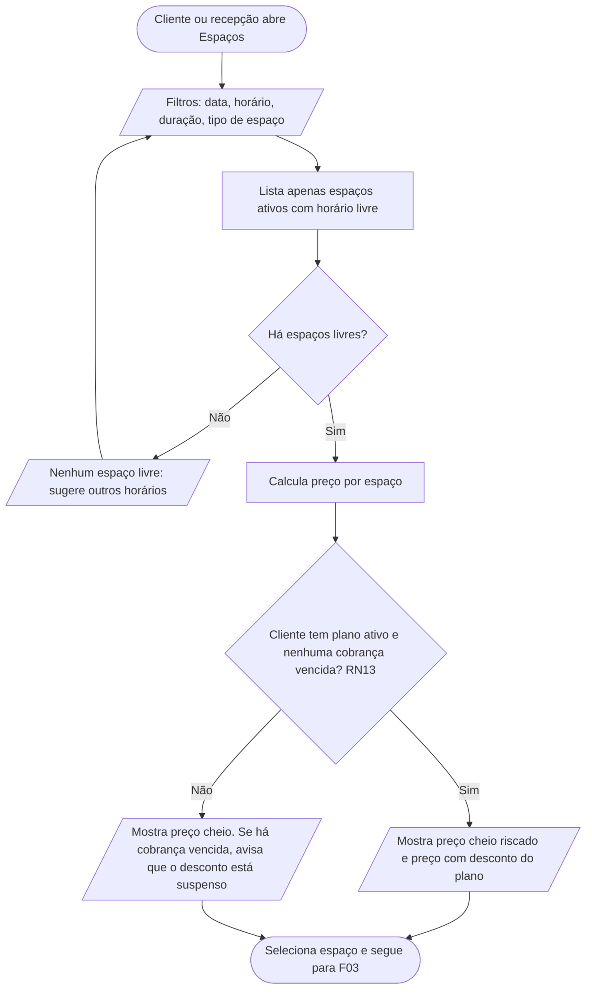


### F03 — Criar reserva (US1, RN01 a RN06, RN12, RN13, FR-004, FR-005)

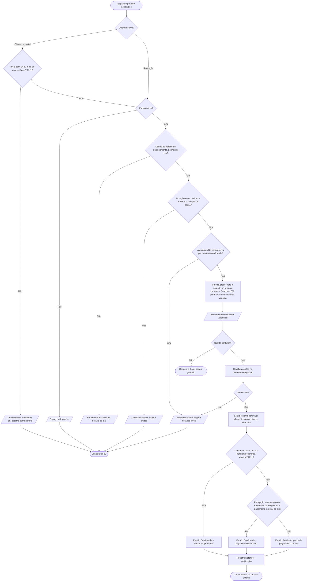


### F04 — Pagar e confirmar reserva, registro manual (US2, RN11, RN12, FR-009)

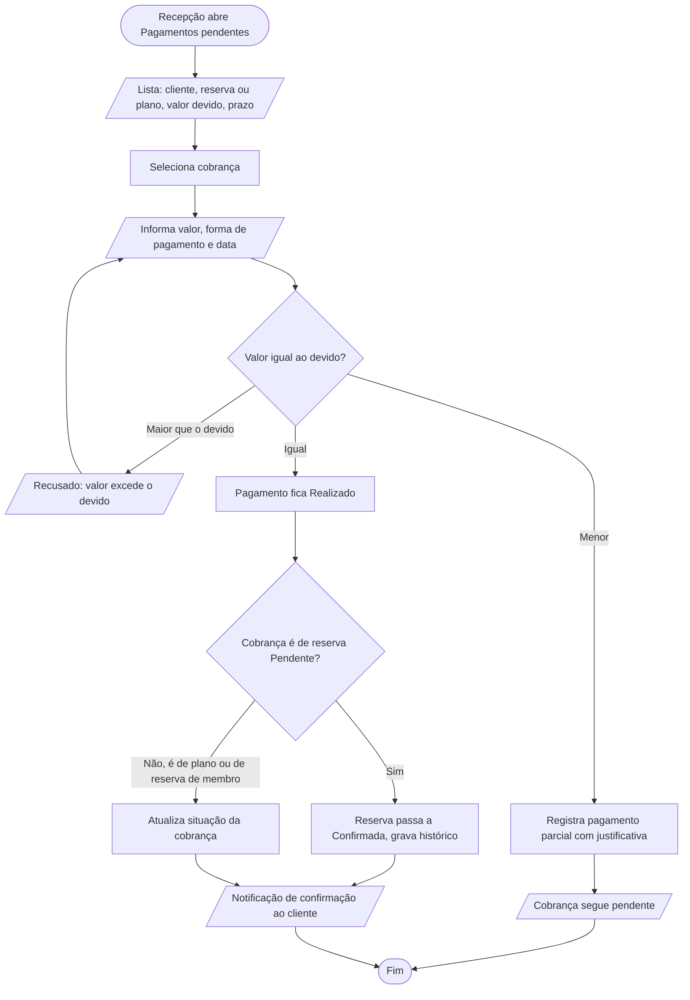


### F05 — Cancelar reserva com multa e estorno (US3, RN07, RN08, RN11, FR-007)

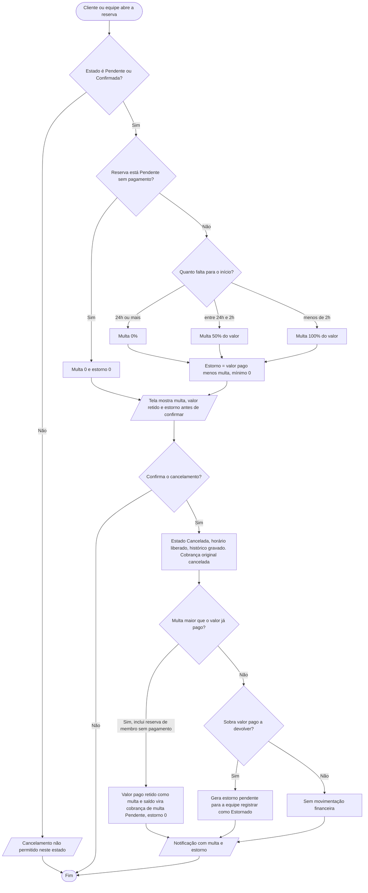


### F06 — Encerrar reserva: concluída ou no-show (US2, RN08, RN10, FR-010)

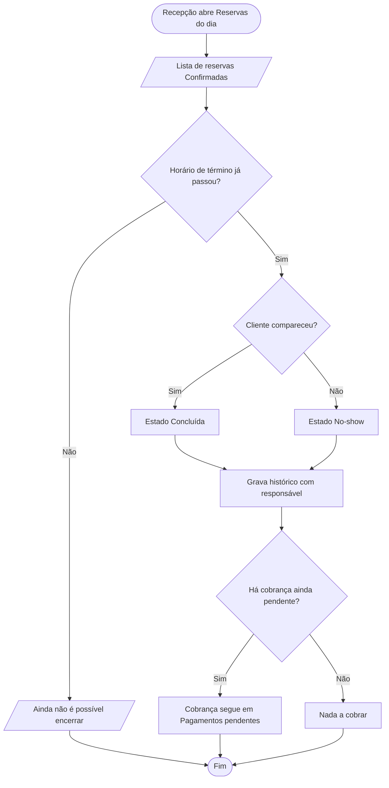

Expiração automática de reservas pendentes (RN12):

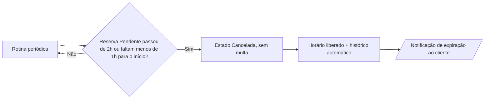


### F07 — Gerir espaços, preços e horários (US5, RN01, RN04, RN05, RN15, FR-012)

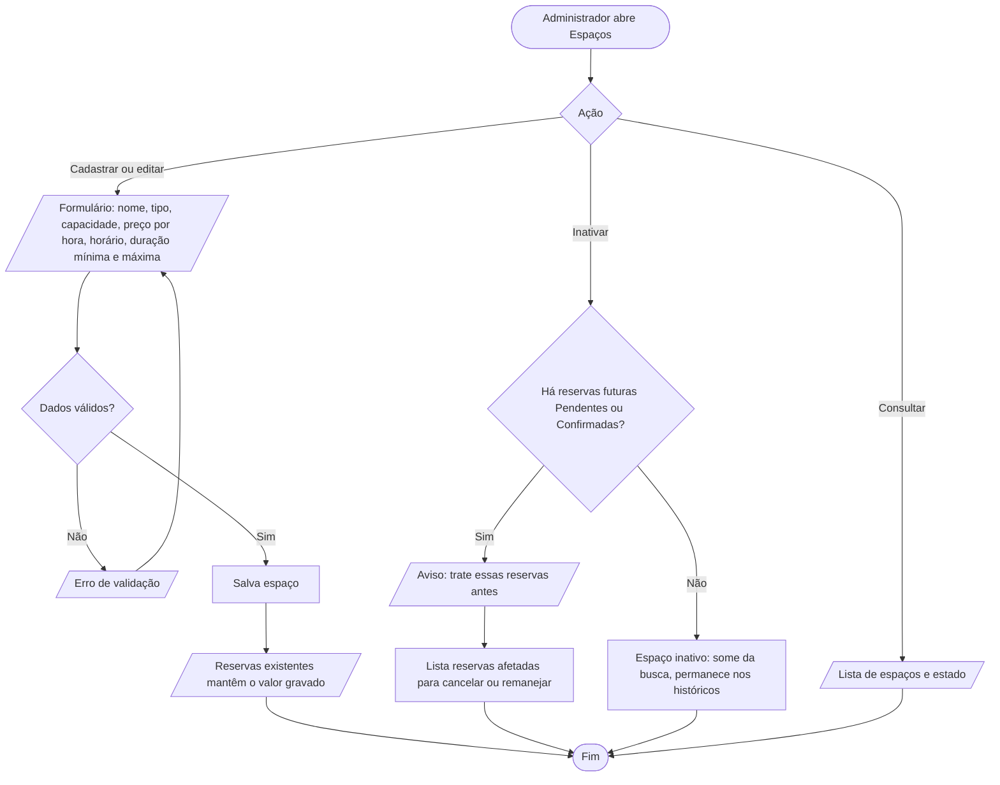


### F08 — Gerir planos e assinatura (US5, US6, RN13, RN16, FR-013)

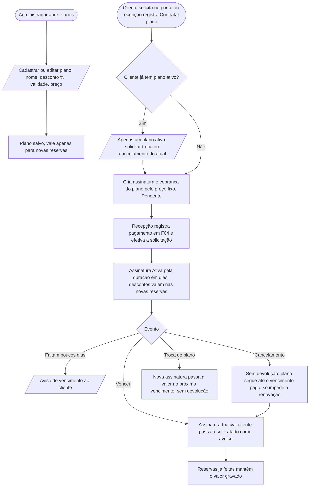


### F09 — Gerir clientes (US4, RN14, RN15, RN17, FR-014)

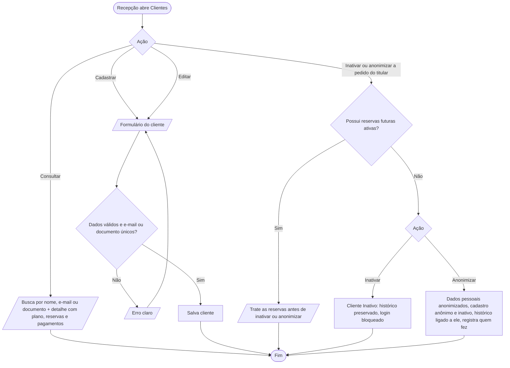


### F10 — Notificações recebidas (US7, RN16, FR-015)

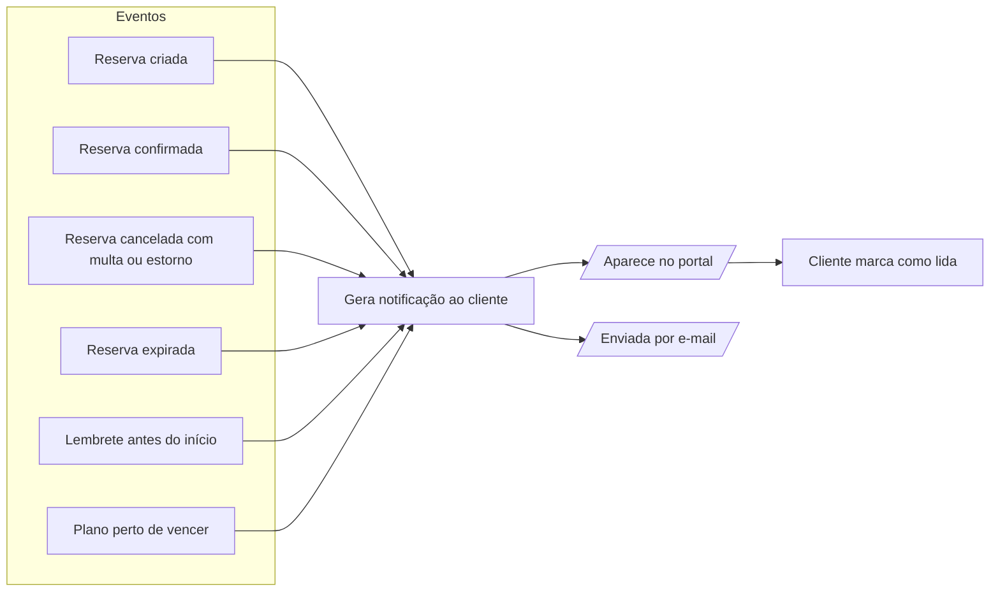


### F11 — Relatórios (US7, RN18, FR-016)

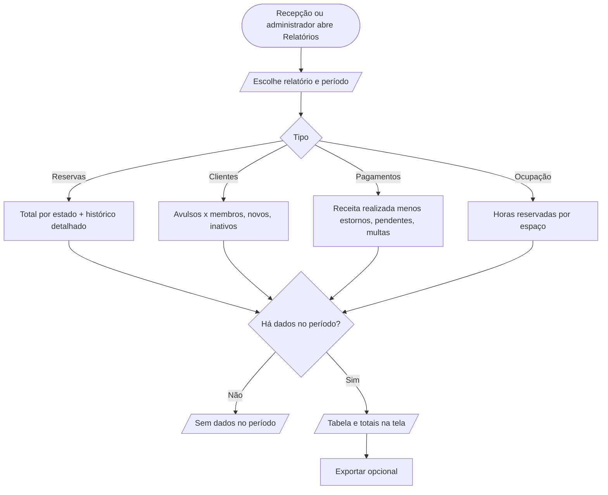


### F12 — Gerir usuários da equipe e permissões (RN17, FR-017)

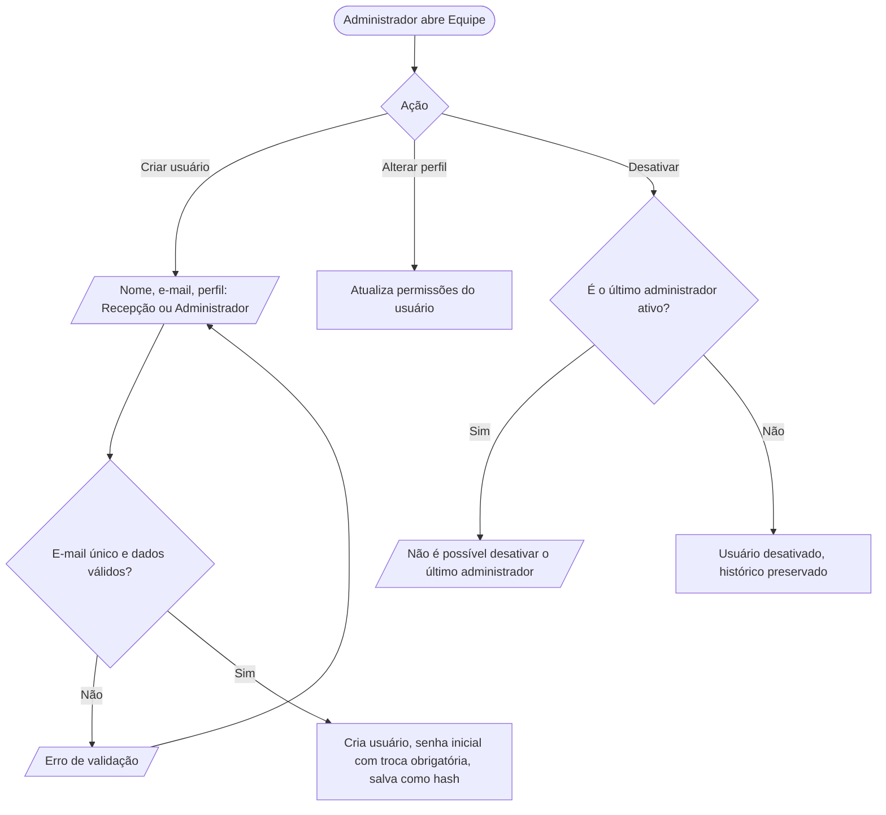

Matriz de permissões (RN17):

| Ação | Cliente | Recepção | Administrador |
|------|:-------:|:--------:|:-------------:|
| Ver e reservar em seu nome | ✔ | ✔ (para qualquer cliente) | ✔ |
| Ver dados de outros clientes | ✘ | ✔ | ✔ |
| Cancelar a própria reserva | ✔ | ✔ (de qualquer cliente) | ✔ |
| Solicitar contratação, troca ou cancelamento de plano | ✔ (só o próprio) | ✔ (efetiva) | ✔ (efetiva) |
| Registrar pagamento e estorno | ✘ | ✔ | ✔ |
| Encerrar reserva (concluída ou no-show) | ✘ | ✔ | ✔ |
| Cadastrar, editar e inativar clientes | ✘ | ✔ | ✔ |
| Gerir espaços, preços e planos | ✘ | ✘ | ✔ |
| Gerir usuários da equipe | ✘ | ✘ | ✔ |
| Relatórios | ✘ | ✔ | ✔ |

---

# Parte 3. Plano do briefing de design

**Branch**: `001-fluxos-reservas-hubbi` (sem git; pasta de spec apenas) | **Date**: 2026-10-06 | **Spec**: spec.md

**Input**: Feature specification from `/specs/001-fluxos-reservas-hubbi/spec.md`

> **Natureza deste plano**: o entregável da v1 é **documento + protótipo navegável** (Constituição,
> Escopo e Restrições). Este plano é, portanto, um **briefing de design** para um agente de design
> (Figma AI ou Claude Design), e não um plano de código. Os artefatos são Markdown e não dependem
> da ferramenta de design escolhida.

### Summary

Traduzir a spec 001 (fluxos F01–F12, RN01–RN18, FR-001–FR-021) em um briefing que um agente de
design consiga executar sozinho: identidade visual do Hubbi, design system (tokens, componentes,
estados), inventário de telas por fluxo com os FR e RN que cada uma realiza (FR-020), estados
obrigatórios, três tamanhos de tela (FR-021) e critérios de aceite ligados aos SC. As regras de
negócio que o usuário precisa *ver* (preço, multa e estorno antes de confirmar) têm texto e
comportamento definidos em contracts/ui-messages.md.

### Technical Context

**Language/Version**: N/A (entregável de design; Markdown como formato de briefing)

**Primary Dependencies**: Ferramenta de design a definir (Figma ou Claude Design); briefing agnóstico. Imagens da marca recebidas: paleta e logo (ver Identidade Visual); copiar os originais, de preferência vetoriais, para a pasta do projeto antes de entregar ao agente.

**Storage**: N/A (sem persistência; protótipo usa dados de exemplo)

**Testing**: Verificação do protótipo contra quickstart.md (cenários de aceite) e teste de usabilidade com 5 pessoas (SC-007)

**Target Platform**: Computador, tablet e celular (FR-021): frames de 1440, 768 e 390 px de largura

**Project Type**: Protótipo navegável de aplicação web responsiva (Portal do Cliente + Painel da Equipe)

**Performance Goals**: Operações comuns em até 2 s (FR-021, SC-009); no protótipo, estados de carregamento desenhados para qualquer espera acima de 400 ms

**Constraints**: Stack tecnológica não é restrição (Constituição); acessibilidade mínima WCAG 2.2 AA (contraste verificado em research.md); textos em português do Brasil; sem gateway de pagamento (pagamento sempre manual pela equipe)

**Scale/Scope**: 12 fluxos, 2 superfícies (Portal do Cliente e Painel da Equipe), 45 telas-base × 3 tamanhos (ver contracts/screen-inventory.md)

### Constitution Check

*GATE: passou antes da pesquisa; reavaliado após o desenho (Phase 1) e continua passando.*

| Princípio | Verificação neste plano | Status |
|-----------|-------------------------|--------|
| I. Escopo enxuto | Nenhuma tela para eventos, comunidade, NPS, acesso físico, recorrência ou gateway; só reservas, clientes, planos, preços e pagamentos manuais | Passa |
| II. RN como fonte da verdade | O briefing cita RN por código e nunca reescreve a regra | Passa |
| III. Integridade das reservas | Telas respeitam o ciclo de vida (RN08): ação inválida aparece desabilitada com motivo; não existe botão "excluir reserva" | Passa |
| IV. Precificação transparente | Preço cheio, desconto, valor final, multa e estorno aparecem antes de confirmar (SC-005); valor congelado visível no detalhe da reserva (RN06) | Passa |
| V. Rastreabilidade | Cada tela cita FR e RN; cada fluxo cobre caminho feliz e erros (FR-020); códigos estáveis | Passa |
| VI. Segurança e LGPD | Dois perfis (portal e equipe); mensagem de login genérica; nenhum dado de outro cliente (SC-008); anonimização prevista (RN15) | Passa |
| Desempenho e responsividade | FR-021 e SC-009 viram frames em 3 tamanhos e estados de carregamento | Passa |
| Versionamento do documento | Quadro de versões em contracts/design-brief-versioning.md | Passa (ver Complexity Tracking) |

Nenhuma violação injustificada.

### Project Structure

#### Documentation (this feature)

```text
specs/001-fluxos-reservas-hubbi/
├── plan.md                              # Este arquivo (briefing de design)
├── spec.md                              # Fonte das regras (RN) e dos requisitos (FR)
├── fluxos.md                            # Diagramas Mermaid F01–F12
├── research.md                          # Phase 0: decisões de design e contraste
├── data-model.md                        # Phase 1: conteúdo e estados que a UI exibe
├── quickstart.md                        # Phase 1: cenários de verificação do protótipo
├── checklists/requirements.md
├── contracts/
│   ├── design-system.md                 # Tokens, tipografia, componentes e estados
│   ├── screen-inventory.md              # Telas por fluxo, com FR, RN e estados
│   ├── ui-messages.md                   # Textos de erro, avisos e resumos financeiros
│   └── design-brief-versioning.md       # Quadro de versionamento do briefing
└── tasks.md                             # Phase 2 (/speckit-tasks; NÃO criado aqui)
```

#### Source Code (repository root)

Não há código-fonte na v1. O entregável fora desta pasta é o arquivo de design, organizado assim:

```text
Arquivo de design "Hubbi v1"
├── 00 Fundamentos        # logo, cores, tipografia, grid, ícones, espaçamentos
├── 01 Componentes        # biblioteca com variantes e estados
├── 02 Portal do Cliente  # F01, F02, F03, F05, F08 (lado cliente), F10
├── 03 Painel da Equipe   # F02, F03, F04, F05, F06, F07, F08, F09, F11, F12
└── 04 Fluxos             # protótipo navegável + legenda de FR e RN por fluxo
```

**Structure Decision**: duas superfícies (Portal do Cliente e Painel da Equipe), por causa dos
dois perfis da Constituição (VI). O Painel é priorizado para computador e tablet; o Portal, para
celular. Os três tamanhos são entregues nas duas superfícies (FR-021).

### Identidade Visual (resumo; detalhes em contracts/design-system.md)

- **Marca**: símbolo de três pessoas ao redor de uma mesa triangular vista de cima ("Três
  pessoas, uma mesa, um ponto de encontro"); wordmark "Hubbi" em sans arredondada. Roxo Hubbi
  `#38265F` (pessoas) e Pervinca `#91A3DC` (mesa). Funciona em 56, 32 e 20 px e como ícone de app
  (fundo roxo escuro).
- **Paleta de interface "Opção C Pervinca"**: Principal `#4A56C8`, Azul suave `#E5E7FA`, Lilás
  suave `#E3D9F6`, Lilás profundo `#654AA6`, Fundo `#F7F6FC`, Texto `#1E1D2B`.
- **Regra de uso**: a Pervinca `#91A3DC` da logo tem contraste 2,31:1 sobre o Fundo e **não** serve
  para texto nem para bordas de controle; usar só no símbolo e em ilustração.
- **Cores semânticas** (sucesso, alerta, erro) não existem na paleta recebida; propostas em
  research.md, **sujeitas a aprovação**.

### Ordem de prototipação (por prioridade das user stories)

| Onda | Histórias | Fluxos | Por quê |
|------|-----------|--------|---------|
| 0 | — | Fundamentos e Componentes | Todas as telas dependem deles |
| 1 | US4 (cadastro mínimo, pré-requisito do login de US1) | F01 | O cliente precisa entrar para reservar |
| 1 | US1, US2 (P1) | F02, F03, F04, F06 | Coração do produto: reservar, pagar, encerrar |
| 2 | US3, US4, US5 (P2) | F05, F09, F07 | Cancelamento com multa, clientes e espaços |
| 3 | US6, US7 (P3) | F08, F10, F11, F12 | Planos, avisos, relatórios e equipe |

Critério de passagem entre ondas: todos os cenários da onda no quickstart.md
verificados nos três tamanhos de tela.

### Decisões abertas (precisam do responsável antes de o agente começar)

1. **Plataforma-alvo**: Figma (Figma AI) ou Claude Design? O briefing é agnóstico; só muda o
   empacotamento da entrega.
2. **Cores semânticas**: aprovar as propostas de research.md.
3. **Tipografia**: a marca mostra sans arredondada sem nomear a fonte. Proposta: Nunito (títulos e
   wordmark) + Inter (corpo). Confirmar a fonte oficial, se existir.
4. **Arquivos da marca**: entregar o símbolo em vetor (versão principal, monocromática e ícone de
   app). As imagens recebidas são rasterizadas.
5. **História para F12** (gestão da equipe): a spec ainda não tem história própria; o briefing
   cobre F12 por FR-017 e RN17 e marca a lacuna.

### Complexity Tracking

| Violation | Why Needed | Simpler Alternative Rejected Because |
|-----------|------------|-------------------------------------|
| Quadro de versionamento em arquivo próprio | A Constituição exige quadro de versionamento para toda alteração no documento ou no protótipo | Colocá-lo em `plan.md` misturaria histórico com instruções ao agente de design |
| Plano sem "Source Code" tradicional | O entregável é protótipo; stack não é restrição | Inventar estrutura de código contrariaria a independência de tecnologia |

---

# Parte 4. Decisões de design e contraste

Resolve as incógnitas do plano. Todas as decisões são independentes de ferramenta (Figma ou Claude
Design).

### R1. Contraste da paleta recebida

Razões calculadas pela fórmula de luminância relativa do WCAG 2.2.

| Combinação | Razão | Uso permitido |
|------------|------:|---------------|
| Branco sobre Principal `#4A56C8` | 6,08:1 | Texto de botão primário (AA) |
| Principal sobre Fundo `#F7F6FC` | 5,65:1 | Links, ícones ativos, anel de foco (AA) |
| Principal sobre Azul suave `#E5E7FA` | 4,96:1 | Item ativo do menu (AA) |
| Lilás profundo `#654AA6` sobre Lilás suave `#E3D9F6` | 5,03:1 | Etiquetas (AA) |
| Lilás profundo sobre Fundo | 6,34:1 | Texto e ícones secundários (AA) |
| Lilás profundo sobre Azul suave | 5,56:1 | Texto em destaque (AA) |
| Texto `#1E1D2B` sobre Fundo | 15,44:1 | Corpo e títulos (AAA) |
| Texto sobre Azul suave | 13,54:1 | Corpo em áreas de destaque (AAA) |
| Roxo Hubbi `#38265F` sobre Fundo | 12,13:1 | Símbolo e wordmark |
| Pervinca da logo `#91A3DC` sobre Fundo | **2,31:1** | **Só decoração.** Reprova AA para texto e para controles |

**Decisão**: a paleta cobre texto, ações e destaques em AA. A Pervinca `#91A3DC` fica restrita ao
símbolo e a ilustrações.
**Alternativa rejeitada**: usar a Pervinca em bordas de campos (reprova 3:1 para componentes).

### R2. Cores semânticas ausentes

A paleta recebida não define erro, sucesso nem alerta. Sem elas não há como diferenciar "multa" de
"estorno" ou "pendente" de "confirmada". **Propostas** (a aprovar):

| Papel | Fundo suave | Texto e ícone | Observação |
|-------|-------------|---------------|------------|
| Sucesso (confirmada, realizado) | `#E3F4EA` | `#17633A` | Validar contraste na ferramenta |
| Alerta (pendente, prazo perto) | `#FDF1D8` | `#7A4B00` | Validar contraste na ferramenta |
| Erro (cancelada, multa, validação) | `#FBE3E3` | `#A12626` | Validar contraste na ferramenta |
| Informação | Azul suave `#E5E7FA` | Principal `#4A56C8` | 4,96:1 |
| Neutro (concluída, inativo) | `#ECEBF3` | `#4A4860` | Validar contraste na ferramenta |

Os pares de sucesso, alerta, erro e neutro **não foram calculados**; devem atingir pelo menos
4,5:1 na verificação da ferramenta, escurecendo o texto se necessário.
Regra: **nunca comunicar estado só por cor**. Todo estado tem rótulo de texto e ícone.

### R3. Tokens derivados

- **Borda de campo**: Texto `#1E1D2B` a 40% sobre Fundo (alvo ≥ 3:1 para controles).
- **Foco visível**: anel de 2 px em Principal com deslocamento de 2 px, em todo controle.
- **Superfícies**: Fundo `#F7F6FC` na base; cartões brancos com sombra suave e borda de 1 px em
  Texto a 8%; Azul suave para seleção e hover.
- **Desabilitado**: o motivo aparece em texto ao lado ou em dica (ex.: RN08), nunca só o controle
  apagado.

### R4. Tipografia

A marca mostra sans arredondada sem nomear a fonte. **Decisão**: Nunito para títulos e wordmark;
Inter para corpo, tabelas e formulários. Escala: 12, 14 (corpo), 16, 20, 24, 32.
**Alternativa**: só Nunito; rejeitada porque tabelas de pagamentos ficam menos legíveis em tamanho
pequeno. Confirmar a fonte oficial, se existir.

### R5. Responsividade (FR-021)

Três frames por tela: Computador 1440 px, Tablet 768 px, Celular 390 px. Grid de 12 colunas
(computador), 8 (tablet) e 4 (celular), com margens de 32, 24 e 16 px.

- **Portal do Cliente**: prioridade celular. Navegação inferior com 4 itens (Espaços, Reservas,
  Plano, Avisos); perfil no topo.
- **Painel da Equipe**: prioridade computador e tablet. Menu lateral recolhível; no celular vira
  gaveta. Tabelas viram listas de cartões no celular.
- Alvos de toque de no mínimo 44 × 44 px.

### R6. Ações financeiras e destrutivas

SC-005 exige mostrar multa e estorno **antes** de confirmar. **Decisão**: toda ação com efeito
financeiro (cancelar, registrar pagamento, estornar) e a anonimização abrem um painel de
confirmação com resumo de valores e dois botões: ação principal com verbo e valor (ex.:
"Cancelar e reter R$ 100,00") e "Voltar". Sem confirmação genérica "Tem certeza?".

### R7. Dados de exemplo

Dados fictícios coerentes com a spec (ver data-model.md): espaços no padrão da
marca (Sala Aurora, até 8 pessoas, 3º andar), três planos (10%, 20%, 30%), clientes com e sem
plano e um cliente com cobrança vencida.

### R8. Formatos de exibição

- Moeda `R$ 1.234,56`. Data `06/10/2026`; em listas, "ter, 6 out". Hora `14:30` (24 h).
- Duração `1h30`. Intervalo `14:00 – 15:30`. Antecedência no cancelamento: "faltam 5h 20min".
- Não exibir fuso; vale o horário local do espaço.

### R9. Ícones

Conjunto único de traço (2 px, cantos arredondados) para combinar com o símbolo: calendário,
relógio, pessoas, local, valor, sino, alerta, check, fechar, filtro, busca, usuário, engrenagem,
gráfico, plano, espaço, cadeado.

### Incógnitas restantes

Nenhuma bloqueia o início do desenho. Pendentes de aprovação: plataforma, cores semânticas, fonte
oficial, vetores da marca (ver plan.md).

---

# Parte 5. Conteúdo e estados que a interface exibe

Modelo de **conteúdo** para o agente de design: que campos cada objeto mostra, quais estados
existem e como cada estado aparece. Não descreve banco de dados. As regras vêm da
spec; aqui só se cita o código (RNxx).

### 1. Objetos e campos exibidos

#### Cliente
| Campo | Obrigatório | Validação visível | Regra |
|-------|:-----------:|-------------------|-------|
| Nome | Sim | Texto, até 100 caracteres | — |
| E-mail | Sim | Formato de e-mail; único | RN14 |
| Documento | Sim | Formato válido; único | RN14 |
| Telefone | Sim | Formato com DDD | — |
| Senha | Sim (cadastro) | Mínimo de 8 caracteres, com letra e número; nunca exibida | FR-019 |
| Situação | — | Ativo, Inativo, Anonimizado | RN15 |
| Tipo derivado | — | Avulso, Membro, Membro com pendência | RN13 |

"Membro com pendência" é um estado derivado: plano ativo **e** cobrança vencida. Nele, o preço é
cheio e a reserva nasce pendente (RN13). A interface mostra um aviso, não um novo tipo de conta.

#### Espaço
Nome, tipo (sala, mesa, estação), capacidade (pessoas), andar ou local, preço por hora,
horário de funcionamento por dia (padrão 07h–22h, segunda a sábado), duração mínima (padrão 1h),
duração máxima (padrão 8h), passo de agendamento (padrão 30 min), situação (Ativo, Inativo).
Regras: RN01, RN04, RN05, RN15. Mesa hot-desk é espaço de capacidade 1.

#### Plano e Assinatura
- **Plano**: nome, desconto (%), preço fixo (R$), duração em dias, situação (Ativo, Inativo).
- **Assinatura**: cliente, plano, início, vencimento, situação (Solicitada, Ativa, Vencida,
  Cancelada). "Solicitada" é a assinatura pedida pelo cliente que aguarda o pagamento. Regras:
  RN13 e as clarificações de 2026-10-06.

#### Reserva
Código, cliente, espaço, data, início, fim, duração, **valor cheio, desconto aplicado (%), plano
vigente na criação e valor final (congelados, RN06)**, estado, histórico de estados (data, hora,
responsável, RN09), cobrança vinculada.

#### Pagamento ou Cobrança
Código, cliente, vínculo (reserva ou plano), tipo (Reserva, Plano, Multa, Estorno), valor devido,
valor pago, forma de pagamento, data, situação (Pendente, Realizado, Estornado), justificativa
(obrigatória em pagamento parcial). Regras: RN11, RN12.

#### Notificação
Tipo (reserva criada, confirmada, cancelada, expirada, lembrete de início, plano perto de
vencer, boas-vindas), título, texto, data e hora, lida ou não lida. Regra: RN16.

#### Usuário da Equipe
Nome, e-mail, perfil (Recepção, Administrador), situação (Ativo, Desativado). Regra: RN17.

### 2. Estados da reserva e como aparecem

Rótulos e cores vêm do design-system.md. Todo estado tem **rótulo +
ícone + cor**, nunca só cor.

| Estado | Rótulo | Papel de cor | Ícone | Final? |
|--------|--------|--------------|-------|:------:|
| Pendente | Aguardando pagamento | Alerta | relógio | Não |
| Confirmada | Confirmada | Sucesso | check | Não |
| Concluída | Concluída | Neutro | check duplo | Sim |
| Cancelada | Cancelada | Erro | fechar | Sim |
| No-show | Não compareceu | Erro (tom neutro) | alerta | Sim |

Transições permitidas (RN08): Pendente→Confirmada, Pendente→Cancelada, Confirmada→Cancelada,
Confirmada→Concluída, Confirmada→No-show. Qualquer outra ação aparece **desabilitada com o motivo
em texto**.

### 3. Ações disponíveis por estado e ator

"✔" ação ativa; "—" ação oculta; "🔒" desabilitada com motivo.

| Ação | Pendente | Confirmada | Concluída | Cancelada | No-show |
|------|:--------:|:----------:|:---------:|:---------:|:-------:|
| Cancelar (cliente) | ✔ | ✔ | 🔒 estado final | 🔒 estado final | 🔒 estado final |
| Cancelar (equipe) | ✔ | ✔ | 🔒 | 🔒 | 🔒 |
| Registrar pagamento (equipe) | ✔ | ✔ se houver cobrança pendente | — | — | ✔ se houver cobrança pendente |
| Concluir ou marcar no-show (equipe) | — | ✔ só após o término; antes, 🔒 "só depois do término" | — | — | — |
| Ver histórico | ✔ | ✔ | ✔ | ✔ | ✔ |
| Excluir | nunca existe (RN09) | | | | |

### 4. Valores derivados exibidos

| Valor | Fórmula (RN) | Onde aparece |
|-------|--------------|--------------|
| Preço da reserva | preço/hora × duração em horas × (1 − desconto) (RN02) | Busca, resumo, detalhe |
| Desconto aplicado | % do plano ativo; 0% para avulso, plano vencido ou cobrança vencida (RN02, RN13) | Resumo, detalhe |
| Multa | 0% se faltam 24h ou mais; 50% entre 24h e 2h; 100% com menos de 2h; 0 para pendente sem pagamento (RN07) | Cancelamento |
| Valor retido | menor valor entre o pago e a multa | Cancelamento |
| Estorno | valor pago − multa, mínimo 0 (RN11) | Cancelamento, pagamentos |
| Saldo de multa pendente | multa − valor pago, quando positivo (RN07) | Cancelamento, pagamentos |
| Prazo de pagamento | menor valor entre 2h após a criação e 1h antes do início (RN12) | Detalhe da reserva pendente |
| Receita | pagamentos Realizados − estornos (RN18) | Relatório de pagamentos |

Arredondamento: valores em reais com 2 casas, meio para cima. O protótipo usa números redondos de
exemplo.

### 5. Dados de exemplo para o protótipo

| Item | Exemplo |
|------|---------|
| Espaços | Sala Aurora (sala de reunião, 8 pessoas, 3º andar, R$ 80,00/h); Mesa 12 (hot-desk, 1 pessoa, 2º andar, R$ 15,00/h); Estação Norte (estação, 4 pessoas, 2º andar, R$ 40,00/h) |
| Planos | Essencial (10%, R$ 120,00, 30 dias); Profissional (20%, R$ 250,00, 30 dias); Equipe (30%, R$ 480,00, 30 dias) |
| Clientes | Ana Souza (Membro, Profissional); Bruno Lima (Avulso); Carla Dias (Membro com pendência) |
| Reserva de exemplo | Sala Aurora, 2 h → cheio R$ 160,00; Ana (20%) paga R$ 128,00; Bruno paga R$ 160,00 |
| Multa de exemplo | Reserva de R$ 160,00 paga: com 24h ou mais, sem multa; entre 24h e 2h, retém R$ 80,00 e estorna R$ 80,00; com menos de 2h, retém R$ 160,00 |
| Equipe | Marina (Administradora), Paulo (Recepção) |

Todos os dados são fictícios e não devem conter pessoas reais.

---

# Parte 6. Design system

Tokens, tipografia e componentes que o agente de design deve criar **antes** das telas (Onda 0).
Nomes de token são sugestões estáveis; manter os mesmos nomes na biblioteca da ferramenta.

### 1. Marca

- **Símbolo**: três pessoas (cabeça e ombros, vistas de cima) sentadas ao redor de uma mesa
  triangular. Pessoas em Roxo Hubbi `#38265F`; mesa em Pervinca `#91A3DC`. Conceito: "Três pessoas,
  uma mesa, um ponto de encontro".
- **Wordmark**: "Hubbi" em sans arredondada, Roxo Hubbi, abaixo ou ao lado do símbolo.
- **Versões a entregar**: principal (vertical), horizontal (símbolo + wordmark), apenas símbolo,
  monocromática, ícone de app (símbolo claro sobre fundo Roxo Hubbi).
- **Tamanhos validados pela marca**: símbolo em 56, 32 e 20 px. Abaixo de 20 px não usar.
- **Uso em interface**: logo no topo do menu lateral (computador e tablet) e no topo do portal
  (celular). Respiro mínimo ao redor igual à altura da cabeça de uma das pessoas.
- **Proibido**: recolorir o símbolo com cores fora da marca; usar a Pervinca como texto.

### 2. Cores

#### Base da interface (recebida: "Opção C Pervinca")
| Token | Hex | Uso |
|-------|-----|-----|
| `color.primary` | `#4A56C8` | Botões, links, item ativo, anel de foco |
| `color.primary-soft` | `#E5E7FA` | Menu ativo, seleção, fundos de destaque |
| `color.lilac-soft` | `#E3D9F6` | Etiquetas, ilustrações, detalhes |
| `color.lilac-deep` | `#654AA6` | Texto e ícones sobre lilás |
| `color.background` | `#F7F6FC` | Base das telas |
| `color.text` | `#1E1D2B` | Títulos e corpo |
| `color.surface` | `#FFFFFF` | Cartões, painéis, campos |

#### Marca (somente logo e ilustração)
| Token | Hex |
|-------|-----|
| `brand.purple` | `#38265F` |
| `brand.periwinkle` | `#91A3DC` |

#### Semânticas (propostas, a aprovar; ver research.md R2)
| Papel | Fundo | Texto e ícone |
|-------|-------|---------------|
| `success` | `#E3F4EA` | `#17633A` |
| `warning` | `#FDF1D8` | `#7A4B00` |
| `danger` | `#FBE3E3` | `#A12626` |
| `neutral` | `#ECEBF3` | `#4A4860` |
| `info` | `#E5E7FA` | `#4A56C8` |

**Regras**: contraste mínimo 4,5:1 para texto e 3:1 para controles; estado nunca só por cor;
modo escuro fora da v1.

### 3. Tipografia

Proposta (a confirmar): **Nunito** para títulos e wordmark; **Inter** para corpo, tabelas e campos.

| Estilo | Tamanho / altura de linha | Peso | Uso |
|--------|---------------------------|------|-----|
| Display | 32 / 40 | Nunito 800 | Títulos de página no computador |
| Título 1 | 24 / 32 | Nunito 700 | Títulos de seção; telas no celular |
| Título 2 | 20 / 28 | Nunito 700 | Cartões e painéis |
| Corpo grande | 16 / 24 | Inter 400 | Texto destacado e campos |
| Corpo | 14 / 20 | Inter 400 | Texto padrão |
| Corpo forte | 14 / 20 | Inter 600 | Valores, rótulos |
| Legenda | 12 / 16 | Inter 500 | Etiquetas, dicas, tabelas densas |
| Valor financeiro | 24 / 32 | Inter 700, números tabulares | Totais, multa, estorno |

### 4. Espaçamento, forma e elevação

- **Escala de espaçamento**: 4, 8, 12, 16, 24, 32, 48 px.
- **Raio**: 8 px (campos, botões), 16 px (cartões), 999 px (etiquetas e chips).
- **Elevação**: nível 0 (plano), nível 1 (cartão: sombra suave), nível 2 (painéis e menus).
- **Grid**: 12 colunas no computador (1440 px, margem 32), 8 no tablet (768 px, margem 24),
  4 no celular (390 px, margem 16); calha de 24, 16 e 16 px.
- **Alvos de toque**: mínimo 44 × 44 px.

### 5. Componentes e estados

Criar todas as variantes e estados. Estados universais: **padrão, hover, foco, pressionado,
desabilitado, carregando, erro**.

| Componente | Variantes | Observações |
|------------|-----------|-------------|
| Botão | Primário, secundário, texto (link), destrutivo; tamanhos M e G; com ícone | Primário: branco sobre `color.primary`; destrutivo usa `danger` |
| Campo de texto | Padrão, com ícone, com dica, com erro | Rótulo sempre visível; erro em texto abaixo do campo |
| Campo de senha | Com mostrar e ocultar | — |
| Seletor (select) | Simples, múltiplo | — |
| Seletor de data | Dia, intervalo | Desabilita dias sem funcionamento |
| Seletor de horário | Grade de blocos de 30 min | Estados: livre, ocupado, fora do horário, selecionado |
| Seletor de duração | Passos de 30 min entre mínimo e máximo | Mostra os limites |
| Etiqueta de tipo | Sala de reunião, mesa, estação | Fundo `lilac-soft`, texto `lilac-deep` (como no exemplo da marca) |
| Selo de estado | Reserva: Aguardando pagamento, Confirmada, Concluída, Cancelada, Não compareceu; Pagamento: Pendente, Realizado, Estornado; Assinatura: Solicitada, Ativa, Vencida, Cancelada | Rótulo + ícone + cor |
| Cartão de espaço | Lista, grade, selecionado, indisponível | Ver seção 6 |
| Cartão de reserva | Compacto, detalhado | Mostra estado, período, valor final |
| Linha de preço | Cheio, desconto, total, multa, retido, estorno | Números tabulares |
| Resumo financeiro | Reserva, cancelamento, pagamento | Linhas de preço e total em destaque (ver ui-messages.md) |
| Tabela | Padrão, com ordenação, linha selecionada, vazia | No celular vira lista de cartões |
| Filtros | Barra de filtros, chips ativos | — |
| Menu lateral | Expandido, recolhido, item ativo (`primary-soft` + `primary`) | Painel, computador e tablet |
| Navegação inferior | 4 itens com item ativo | Portal, celular |
| Gaveta de menu | Fechada, aberta | Painel, celular |
| Painel de confirmação | Modal (computador e tablet), folha inferior (celular) | Obrigatório para ações financeiras (R6) |
| Aviso em linha | Info, sucesso, alerta, erro | Ícone + texto, ação opcional |
| Notificação rápida (toast) | Sucesso, erro | Some em 5 s; pode ser dispensada |
| Estado vazio | Ilustração em `lilac-soft` + ação sugerida | Obrigatório em toda lista |
| Esqueleto de carregamento | Cartão, linha de tabela, formulário | Para esperas acima de 400 ms |
| Linha do tempo | Item com estado, data, hora, responsável | Histórico (RN09) |
| Item de aviso | Lido, não lido | Central de avisos |
| Indicador de sino | Com contador | — |
| Avatar | Com iniciais | — |
| Cartão de métrica | Número + descrição | Relatórios |
| Gráfico de barras e colunas | Com legenda e tabela alternativa | Relatórios |
| Passos (stepper) | 3 passos: Espaço, Horário, Resumo | Criação de reserva |
| Seletor de plano | Cartão com desconto, preço e duração | — |
| Seletor de cliente | Busca com resultado | Reserva em nome do cliente |

### 6. Cartão de espaço (referência da marca)

Ordem dos elementos: etiqueta de tipo ("Sala de reunião"), nome ("Sala Aurora"), capacidade e
local ("até 8 pessoas · 3º andar"), preço por hora, botão primário "Reservar" e link "Detalhes".
Para membro, mostrar o preço cheio riscado e o preço com desconto (F02). Indisponível: botão
desabilitado com motivo ("Sem horário livre neste período").

### 7. Acessibilidade

Contraste conforme research.md R1; foco visível em todo controle; ordem de
tabulação lógica; rótulo em todo campo; erro descrito em texto e associado ao campo; alvos de
toque de 44 px; gráficos com tabela alternativa; ações com verbo claro.

---

# Parte 7. Inventário de telas

Lista de **45 telas-base**. Cada tela é entregue em **3 tamanhos** (computador 1440 px, tablet
768 px, celular 390 px; FR-021) e com os estados obrigatórios indicados. Cada linha cita os FR e
as RN que a tela realiza (FR-020). Detalhes de fluxo: fluxos.md. Textos:
ui-messages.md. Componentes: design-system.md.

**Legenda de estados**: **P** padrão · **C** carregando · **V** vazio · **E** erro · **S** sucesso
ou confirmação. Telas de formulário têm também **validação em campo**. Toda tela autenticada tem
estado **acesso negado** quando o perfil não permite (RN17).
**Superfície**: **Portal** (cliente) ou **Painel** (equipe).
**Onda**: ordem de prototipação do plan.md.

### F01 — Cadastro e login (US4; FR-001, FR-002, FR-019; RN14, RN17)

| ID | Tela | Superfície | FR | RN | Estados | Onda | Notas |
|----|------|------------|----|----|---------|:----:|-------|
| T01 | Cadastro | Portal | FR-001, FR-019 | RN14 | P, E, S | 1 | Campos: nome, e-mail, documento, telefone, senha. Erros por campo; e-mail ou documento já cadastrado → MSG-01 com ações "Entrar" e "Recuperar senha" |
| T02 | Login | Portal e Painel | FR-002 | RN17 | P, C, E | 1 | Mesma tela para cliente e equipe; o perfil define o destino (T45 ou T21). Erro genérico MSG-02, nunca indica qual campo falhou |
| T03 | Recuperar senha | Portal e Painel | FR-002 | — | P, S, E | 1 | **Lacuna:** a spec cita "recuperar senha" no F01, mas não tem FR ou RN dela. Desenhar o caminho básico (e-mail → confirmação) e marcar como "a confirmar" |
| T44 | Meu perfil | Portal | FR-002 | RN17 | P, C, E, S | 2 | Cliente vê e edita só os próprios dados (SC-008); troca de senha |

### F02 — Consultar disponibilidade e preço (US1; FR-003; RN01, RN02, RN06)

| ID | Tela | Superfície | FR | RN | Estados | Onda | Notas |
|----|------|------------|----|----|---------|:----:|-------|
| T04 | Espaços: busca e lista | Portal | FR-003 | RN01, RN02, RN13 | P, C, V, E | 1 | Filtros: data, horário, duração, tipo. Lista só espaços ativos com horário livre. Membro vê preço cheio riscado + com desconto; avulso e membro com pendência veem só o cheio, este com aviso MSG-18. **Visitante** pode abrir T04 sem login e vê preços cheios (ator da spec; sem fluxo próprio, marcar como "a confirmar"). Vazio: MSG-03 com sugestão de outros horários |
| T05 | Detalhe do espaço | Portal | FR-003 | RN01, RN04, RN05 | P, C, E | 1 | Grade de horários livres e ocupados do dia, limites de duração, horário de funcionamento. Botão "Reservar" leva a T07 |
| T06 | Espaços: busca | Painel | FR-003 | RN01, RN02 | P, C, V, E | 1 | Mesma lógica de T04, com seletor de cliente para calcular o preço do cliente escolhido |

### F03 — Criar reserva (US1, US2; FR-004, FR-005; RN01–RN06, RN12, RN13)

| ID | Tela | Superfície | FR | RN | Estados | Onda | Notas |
|----|------|------------|----|----|---------|:----:|-------|
| T07 | Resumo da reserva | Portal | FR-004, FR-005 | RN02–RN06, RN12, RN13 | P, C, E, S | 1 | Resumo financeiro (cheio, desconto, total) antes de confirmar. Erros: MSG-04 a MSG-08. Explica o que acontece depois: membro → "Confirmada"; avulso → "Aguardando pagamento" com prazo (MSG-09) |
| T08 | Comprovante de reserva | Portal | FR-004 | RN06, RN09 | P | 1 | Código, espaço, período, valores congelados, estado, prazo de pagamento quando pendente |
| T09 | Nova reserva | Painel | FR-004 | RN01–RN05 | P, C, V, E | 1 | 3 passos: cliente → espaço e período → resumo. Recepção pode escolher início com menos de 1h (RN12) |
| T10 | Resumo e confirmação | Painel | FR-004, FR-005, FR-009 | RN06, RN12, RN13 | P, C, E, S | 1 | Quando o início é em menos de 1h, oferece registrar o pagamento integral no ato (reserva nasce Confirmada) |
| T11 | Minhas reservas | Portal | FR-006, FR-011 | RN08, RN09 | P, C, V, E | 1 | Abas: Próximas, Passadas, Canceladas; selo de estado; ação "Cancelar" conforme data-model.md seção 3 |
| T12 | Detalhe da reserva | Portal | FR-005, FR-006, FR-011 | RN06, RN08, RN09 | P, C, E | 1 | Valores congelados, linha do tempo, prazo de pagamento, botão "Cancelar" |
| T13 | Reservas (lista e agenda) | Painel | FR-006, FR-011 | RN08, RN09 | P, C, V, E | 1 | Visões lista e agenda por espaço; filtros por estado, data, cliente |
| T14 | Detalhe da reserva | Painel | FR-005, FR-006, FR-009, FR-011 | RN06, RN08, RN09, RN10 | P, C, E | 1 | Ações por estado (seção 3 do data-model): pagar, cancelar, encerrar; linha do tempo com responsável |

### F04 — Pagar e confirmar reserva (US2; FR-009; RN11, RN12)

| ID | Tela | Superfície | FR | RN | Estados | Onda | Notas |
|----|------|------------|----|----|---------|:----:|-------|
| T15 | Pagamentos pendentes | Painel | FR-009 | RN12, RN13 | P, C, V, E | 1 | Lista: cliente, reserva ou plano, valor devido, prazo; destaque para vencidos e prazos próximos |
| T16 | Registrar pagamento | Painel | FR-009 | RN11, RN12 | P, C, E, S | 1 | Valor, forma, data. Maior que o devido: MSG-10 (recusado). Menor: pagamento parcial com justificativa obrigatória (MSG-11); cobrança segue pendente. Igual: Realizado e, se for reserva pendente, vira Confirmada |
| T17 | Pagamentos realizados e estornos | Painel | FR-009 | RN11, RN18 | P, C, V, E | 1 | Histórico com filtros e selos Pendente, Realizado, Estornado |

### F05 — Cancelar reserva (US3; FR-007; RN07, RN08, RN11)

| ID | Tela | Superfície | FR | RN | Estados | Onda | Notas |
|----|------|------------|----|----|---------|:----:|-------|
| T18 | Cancelar reserva | Portal | FR-007 | RN07, RN08, RN11 | P, C, E, S | 2 | Painel de confirmação com **multa, valor retido e estorno antes do botão** (SC-005); textos MSG-12 a MSG-16; botão com verbo e valor |
| T19 | Cancelar reserva | Painel | FR-007 | RN07, RN08, RN11 | P, C, E, S | 2 | Mesma regra de T18, com justificativa opcional |
| T20 | Registrar estorno | Painel | FR-009 | RN11 | P, C, V, E, S | 2 | Lista de estornos pendentes; registrar vira Estornado; multa pendente aparece em T15 |

### F06 — Encerrar reserva (US2; FR-010; RN08, RN10)

| ID | Tela | Superfície | FR | RN | Estados | Onda | Notas |
|----|------|------------|----|----|---------|:----:|-------|
| T21 | Reservas do dia | Painel | FR-010, FR-006 | RN08, RN10 | P, C, V, E | 1 | **Tela inicial da equipe.** Lista de reservas Confirmadas do dia com ação "Concluir" e "Não compareceu"; antes do término a ação fica desabilitada com MSG-17 |
| T22 | Encerrar reserva | Painel | FR-010 | RN08, RN09, RN10 | P, S, E | 1 | Confirmação com resultado (Concluída ou Não compareceu) e aviso de cobrança que segue pendente |

### F07 — Gerir espaços, preços e horários (US5; FR-012; RN01, RN04, RN05, RN15)

| ID | Tela | Superfície | FR | RN | Estados | Onda | Notas |
|----|------|------------|----|----|---------|:----:|-------|
| T23 | Espaços | Painel | FR-012 | RN15 | P, C, V, E | 2 | Lista com situação, preço/hora, capacidade; busca |
| T24 | Cadastrar ou editar espaço | Painel | FR-012 | RN01, RN04, RN05 | P, E, S | 2 | Nome, tipo, capacidade, local, preço/hora, horário por dia, duração mínima e máxima. Aviso MSG-19 de que reservas existentes mantêm o valor gravado (RN06) |
| T25 | Inativar espaço | Painel | FR-012 | RN15 | P, E, S | 2 | Se há reservas futuras: lista as afetadas para cancelar ou remanejar (MSG-20); só inativa depois |

### F08 — Gerir planos e assinatura (US5, US6; FR-013; RN13, RN16)

| ID | Tela | Superfície | FR | RN | Estados | Onda | Notas |
|----|------|------------|----|----|---------|:----:|-------|
| T26 | Planos | Painel (admin) | FR-013 | RN13 | P, C, V, E | 3 | Lista com desconto, preço, duração, situação |
| T27 | Cadastrar ou editar plano | Painel (admin) | FR-013 | RN13 | P, E, S | 3 | Nome, desconto %, preço, duração em dias; aviso de que vale só para novas reservas |
| T28 | Meu plano | Portal | FR-013 | RN13, RN16 | P, C, V, E | 3 | Plano atual, vencimento, aviso de vencimento próximo; ações "Solicitar troca" e "Cancelar plano" (MSG-21: sem devolução). Vazio: convite para contratar |
| T29 | Solicitar plano | Portal | FR-013 | RN13 | P, C, E, S | 3 | Escolha de plano com cartões; resumo com preço, duração e desconto; resultado: "Solicitação enviada, aguardando pagamento" (MSG-22) |
| T30 | Solicitações e assinaturas | Painel | FR-013, FR-009 | RN13 | P, C, V, E | 3 | Solicitações pendentes de pagamento, assinaturas ativas e a vencer; efetivar troca ou cancelamento. Pagamento do plano é registrado em T16 |

### F09 — Gerir clientes (US4; FR-014; RN14, RN15, RN17)

| ID | Tela | Superfície | FR | RN | Estados | Onda | Notas |
|----|------|------------|----|----|---------|:----:|-------|
| T31 | Clientes | Painel | FR-014 | RN17 | P, C, V, E | 2 | Busca por nome, e-mail ou documento; selo Avulso, Membro, Membro com pendência, Inativo |
| T32 | Detalhe do cliente | Painel | FR-014 | RN13, RN17 | P, C, E | 2 | Dados, plano, reservas, pagamentos, cobranças vencidas |
| T33 | Cadastrar ou editar cliente | Painel | FR-014 | RN14, RN17 | P, E, S | 2 | Mesmos campos de T01; erro de duplicidade MSG-01 |
| T34 | Inativar ou anonimizar cliente | Painel | FR-014, FR-019 | RN15 | P, E, S | 2 | Se há reservas futuras: MSG-23. Anonimizar mostra o que será apagado e que histórico permanece (MSG-24); registra responsável |

### F10 — Notificações recebidas (US7; FR-015; RN16)

| ID | Tela | Superfície | FR | RN | Estados | Onda | Notas |
|----|------|------------|----|----|---------|:----:|-------|
| T35 | Central de avisos | Portal | FR-015 | RN16 | P, C, V, E | 3 | Lista com lidos e não lidos, marcar como lida; sino com contador no topo. Tipos: criada, confirmada, cancelada (com multa e estorno), expirada, lembrete, plano perto de vencer, boas-vindas |

### F11 — Relatórios (US7; FR-016; RN18)

| ID | Tela | Superfície | FR | RN | Estados | Onda | Notas |
|----|------|------------|----|----|---------|:----:|-------|
| T36 | Relatórios | Painel | FR-016 | RN18 | P | 3 | Escolha do relatório e do período |
| T37 | Relatório de reservas | Painel | FR-016 | RN18 | P, C, V, E | 3 | Total por estado, histórico detalhado |
| T38 | Relatório de clientes | Painel | FR-016 | RN18 | P, C, V, E | 3 | Avulsos × membros, novos, inativos |
| T39 | Relatório de pagamentos | Painel | FR-016 | RN18 | P, C, V, E | 3 | Receita (realizados − estornos), pendentes, multas |
| T40 | Relatório de ocupação | Painel | FR-016 | RN18 | P, C, V, E | 3 | Horas reservadas por espaço. Vazio: MSG-25 "Sem dados no período". Exportar é opcional |

### F12 — Gerir usuários da equipe e permissões (FR-017; RN17)

| ID | Tela | Superfície | FR | RN | Estados | Onda | Notas |
|----|------|------------|----|----|---------|:----:|-------|
| T41 | Equipe | Painel (admin) | FR-017 | RN17 | P, C, V, E | 3 | Lista de usuários, perfil e situação. **Lacuna:** F12 não tem história de usuário própria na spec |
| T42 | Criar ou editar usuário | Painel (admin) | FR-017 | RN17 | P, E, S | 3 | Nome, e-mail, perfil (Recepção ou Administrador); senha inicial com troca obrigatória |
| T43 | Desativar usuário | Painel (admin) | FR-017 | RN17 | P, E, S | 3 | Bloqueia o último administrador ativo (MSG-26); histórico preservado |

### Navegação inicial

| ID | Tela | Superfície | FR | RN | Estados | Onda | Notas |
|----|------|------------|----|----|---------|:----:|-------|
| T45 | Início do portal | Portal | FR-003 | RN13 | P, C, V | 1 | Próximas reservas, plano atual, atalho "Reservar um espaço" |

(T21 é o início da equipe.)

### Permissões por tela (RN17)

| Perfil | Telas acessíveis |
|--------|------------------|
| Visitante | T01, T02, T03, T04 (somente leitura, preços cheios) |
| Cliente | T04, T05, T07, T08, T11, T12, T18, T28, T29, T35, T44, T45 e as de F01 |
| Recepção | T02, T03, T06, T09, T10, T13–T17, T19–T22, T30–T34, T36–T40 |
| Administrador | Todas da Recepção + T23–T27, T41–T43 |

Tentar abrir tela fora do perfil mostra **acesso negado** (MSG-27), sem revelar dados de outro cliente.

### Cobertura dos fluxos

| Fluxo | Telas | Fluxo | Telas |
|-------|-------|-------|-------|
| F01 | T01, T02, T03, T44 | F07 | T23, T24, T25 |
| F02 | T04, T05, T06 | F08 | T26–T30 |
| F03 | T07–T14 | F09 | T31–T34 |
| F04 | T15–T17 | F10 | T35 |
| F05 | T18–T20 | F11 | T36–T40 |
| F06 | T21, T22 | F12 | T41–T43 |

Total: 45 telas (T01–T45), todas com os três tamanhos.

---

# Parte 8. Textos e regras visíveis na interface

Catálogo de mensagens (**MSG-xx**) referenciado pelo screen-inventory.md.
Idioma: português do Brasil. Variáveis entre `{chaves}`. Cada mensagem cita a regra (RN) que a
origina. Regras gerais:

- Erro diz **qual limite foi violado** e **o que fazer** (SC-002).
- Nenhuma mensagem expõe dados de outro cliente nem revela qual campo de login falhou (FR-018).
- Valores em `R$ 1.234,56`; datas em `06/10/2026`; hora em `14:30`.

### 1. Cadastro e acesso

| ID | Quando | Texto | Componente | RN |
|----|--------|-------|------------|----|
| MSG-01 | E-mail ou documento já cadastrado | "Já existe uma conta com esses dados. Entre ou recupere sua senha." Ações: **Entrar**, **Recuperar senha** | Aviso em linha (erro) | RN14 |
| MSG-02 | Login inválido | "E-mail ou senha incorretos. Confira e tente de novo." (nunca indica qual campo) | Aviso em linha (erro) | RN17 |
| MSG-27 | Perfil sem permissão | "Você não tem acesso a esta página." (sem dados do recurso) | Tela de acesso negado | RN17 |

### 2. Busca e criação de reserva

| ID | Quando | Texto | Componente | RN |
|----|--------|-------|------------|----|
| MSG-03 | Nenhum espaço livre | "Nenhum espaço livre neste horário. Veja outros horários ou tipos de espaço." Ação: **Ver outros horários** | Estado vazio | RN03 |
| MSG-04 | Horário ocupado | "Esse horário já foi reservado. Escolha um dos horários livres abaixo." + sugestões de horários livres do mesmo espaço | Aviso em linha (erro) + chips | RN03 |
| MSG-05 | Fora do horário | "O espaço funciona das {abertura} às {fechamento}, de {dia inicial} a {dia final}. A reserva precisa começar e terminar no mesmo dia, dentro desse horário." | Aviso em linha (erro) | RN04 |
| MSG-06 | Duração inválida | "A duração deve ser de {mínima} a {máxima}, em intervalos de {passo}." | Aviso em linha (erro) | RN05 |
| MSG-07 | Espaço inativo ou indisponível | "Este espaço não está disponível para reserva." | Aviso em linha (erro) | RN01 |
| MSG-08 | Antecedência menor que 1h (portal) | "No portal, a reserva precisa começar com pelo menos 1 hora de antecedência. Escolha outro horário ou procure a recepção." | Aviso em linha (erro) | RN12 |
| MSG-09 | Reserva criada, avulso | "Reserva aguardando pagamento. Pague na recepção até {prazo} para confirmar; depois disso ela é cancelada sem multa." | Aviso em linha (alerta) | RN12 |
| MSG-18 | Membro com cobrança vencida | "Você tem uma cobrança vencida. Enquanto ela estiver aberta, suas reservas valem o preço cheio e ficam aguardando pagamento." Ação: **Ver cobranças** | Banner (alerta) | RN13 |
| — | Reserva criada, membro | "Reserva confirmada. A cobrança de {valor} fica pendente para a recepção registrar." | Toast (sucesso) | RN13 |

#### Resumo da reserva (T07, T10)

Bloco de linhas, nesta ordem (valores com números tabulares):

```text
Sala Aurora · ter, 06/10/2026 · 14:00 – 16:00 (2h)
Preço cheio                       R$ 160,00
Desconto do plano Profissional (20%)  – R$ 32,00      (omitir a linha para avulso)
Total                             R$ 128,00
```

Botão primário: **Confirmar reserva · R$ 128,00**. Botão secundário: **Voltar**.

### 3. Pagamento (F04)

| ID | Quando | Texto | Componente | RN |
|----|--------|-------|------------|----|
| MSG-10 | Valor maior que o devido | "O valor informado (R$ {informado}) é maior que o devido (R$ {devido}). Corrija o valor." | Erro no campo | RN12 |
| MSG-11 | Valor menor que o devido | "Pagamento parcial de R$ {informado} de R$ {devido}. Informe a justificativa. A cobrança continua pendente em R$ {saldo}." | Aviso em linha (alerta) + campo obrigatório | RN12 |
| — | Pagamento integral registrado | "Pagamento registrado. Reserva confirmada." | Toast (sucesso) | RN12 |

### 4. Cancelamento (F05): multa e estorno **antes** de confirmar

Painel de confirmação com resumo. As linhas dependem da faixa:

| ID | Situação | Texto de apoio | RN |
|----|----------|----------------|----|
| MSG-12 | Pendente sem pagamento | "Esta reserva ainda não foi paga. Cancelar não gera multa nem estorno." | RN07 |
| MSG-13 | 24h ou mais antes do início | "Faltam {tempo} para o início. Cancelamento sem multa." | RN07 |
| MSG-14 | Entre 24h e 2h antes | "Faltam {tempo} para o início. Multa de 50% do valor da reserva." | RN07 |
| MSG-15 | Menos de 2h antes | "Faltam {tempo} para o início. Multa de 100% do valor da reserva." | RN07 |
| MSG-16 | Multa maior que o valor pago (inclui membro sem pagamento) | "O valor pago cobre só parte da multa. R$ {pago} ficam retidos e R$ {saldo} viram uma cobrança pendente." | RN07 |

Resumo exibido antes do botão (exemplo com reserva paga de R$ 160,00, entre 24h e 2h):

```text
Valor da reserva                  R$ 160,00
Valor pago                        R$ 160,00
Multa (50%)                      – R$ 80,00
Estorno                           R$ 80,00     (a equipe registra a devolução)
```

Exemplo do caso MSG-16 (membro, nada pago, menos de 2h):

```text
Valor da reserva                  R$ 128,00
Valor pago                        R$ 0,00
Multa (100%)                      R$ 128,00
Valor retido                      R$ 0,00
Cobrança de multa pendente        R$ 128,00
Estorno                           R$ 0,00
```

Botões: primário **Cancelar e reter R$ {retido}** (ou **Cancelar reserva** quando não há valor) e
secundário **Voltar**. Confirmação de sucesso (toast): "Reserva cancelada." Com estorno:
"Reserva cancelada. O estorno de R$ {estorno} será registrado pela recepção."

| ID | Quando | Texto | RN |
|----|--------|-------|----|
| — | Estado final | "Esta reserva não pode mais ser cancelada porque está {concluída, cancelada ou marcada como não compareceu}." (botão desabilitado com este motivo) | RN08 |

### 5. Encerramento (F06)

| ID | Quando | Texto | RN |
|----|--------|-------|----|
| MSG-17 | Antes do término | "Só é possível encerrar a reserva depois do término ({hora do término})." | RN10 |
| — | Concluir | "Marcar como concluída? A cobrança pendente de R$ {valor} continua em Pagamentos pendentes." | RN08 |
| — | Não compareceu | "Marcar como não compareceu? Esta ação não pode ser desfeita." | RN08 |

### 6. Cadastros (F07, F08, F09, F12)

| ID | Quando | Texto | RN |
|----|--------|-------|----|
| MSG-19 | Salvar preço ou desconto | "Esta alteração vale só para novas reservas. Reservas já feitas mantêm o valor original." | RN06 |
| MSG-20 | Inativar espaço com reservas futuras | "Este espaço tem {n} reservas futuras. Cancele ou remaneje essas reservas antes de inativar." Lista as reservas | RN15 |
| MSG-21 | Cancelar ou trocar plano | "Não há devolução do valor pago. O plano continua até {vencimento}; cancelar só impede a renovação, e a troca vale a partir dessa data." | RN13 |
| MSG-22 | Plano solicitado | "Solicitação enviada. O plano é ativado quando a recepção registrar o pagamento de R$ {preço}." | RN13 |
| MSG-23 | Inativar ou anonimizar com reservas futuras | "Este cliente tem {n} reservas futuras. Trate essas reservas antes de continuar." | RN15 |
| MSG-24 | Anonimizar | "Nome, e-mail, documento e telefone serão apagados e o cadastro ficará anônimo e inativo. Reservas e pagamentos permanecem no histórico. Esta ação não pode ser desfeita." Botão: **Anonimizar dados** | RN15 |
| MSG-26 | Desativar último administrador | "Não é possível desativar o último administrador ativo. Crie ou promova outro administrador primeiro." | RN17 |

### 7. Relatórios e avisos

| ID | Quando | Texto | RN |
|----|--------|-------|----|
| MSG-25 | Sem dados | "Sem dados neste período. Escolha outro período." | RN18 |
| — | Aviso de vencimento do plano | "Seu plano {nome} vence em {n} dias. Solicite a renovação para manter o desconto." | RN16 |
| — | Reserva expirada | "Sua reserva de {data} foi cancelada porque o pagamento não foi registrado a tempo. Não há multa." | RN12, RN16 |
| — | Lembrete de início | "Sua reserva na {espaço} começa às {hora}." | RN16 |

### 8. Telas que o agente deve desenhar para cada mensagem de erro

Cada erro de validação aparece em **dois lugares**: junto ao campo (texto curto) e, quando bloqueia
a ação, em aviso em linha no topo do formulário. O foco vai para o primeiro campo com erro.

---

# Parte 9. Verificação do protótipo

Cenários para provar, no protótipo, que o briefing foi atendido. Cada cenário cita a história
(US), os critérios (SC) e as regras (RN). Verificar **nos três tamanhos de tela** (1440, 768 e
390 px; FR-021). Dados de exemplo em data-model.md seção 5.

### Pré-requisitos

- Biblioteca de componentes e tokens publicada (design-system.md).
- Telas T01–T45 prototipadas e ligadas conforme screen-inventory.md.
- Textos conforme ui-messages.md.
- Perfis de teste: Ana (membro), Bruno (avulso), Carla (membro com pendência), Paulo (recepção),
  Marina (administradora).

### Cenários

| ID | Cenário (Given → When → Then) | US | SC | RN |
|----|-------------------------------|----|----|----|
| Q01 | Bruno entra, escolhe Sala Aurora, 2h livres → vê R$ 160,00 cheio → confirma → reserva "Aguardando pagamento" com prazo | US1 | SC-001, SC-003 | RN02, RN12 |
| Q02 | Ana faz a mesma reserva → vê R$ 160,00 riscado e R$ 128,00 → confirma → reserva "Confirmada" e cobrança pendente | US1 | SC-003 | RN02, RN13 |
| Q03 | Reserva em horário ocupado → erro MSG-04 com horários livres sugeridos | US1 | SC-002 | RN03 |
| Q04 | Reserva às 23h, ou 30 min, ou 9h de duração, ou com início em menos de 1h no portal → erros MSG-05, MSG-06, MSG-08, cada um indicando o limite | US1 | SC-002 | RN04, RN05, RN12 |
| Q05 | Carla (membro com pendência) busca espaços → vê só o preço cheio e o banner MSG-18; reserva fica "Aguardando pagamento" | US1 | SC-003 | RN13 |
| Q06 | Paulo registra o pagamento integral da reserva de Bruno → Realizado e reserva "Confirmada" | US2 | SC-004 | RN12 |
| Q07 | Paulo registra valor maior → MSG-10; valor menor → parcial com justificativa e cobrança pendente | US2 | SC-004 | RN12 |
| Q08 | Passa o término de uma reserva confirmada → Paulo marca "Concluída"; antes do término a ação está desabilitada com MSG-17 | US2 | SC-004 | RN08, RN10 |
| Q09 | Cliente abre cancelamento em três faixas (≥ 24h, entre 24h e 2h, < 2h) → vê multa e estorno antes do botão em todas | US3 | SC-005 | RN07, RN11 |
| Q10 | Membro sem pagamento cancela com menos de 2h → vê multa 100% como cobrança pendente e estorno 0 (MSG-16) | US3 | SC-005 | RN07 |
| Q11 | Tentar cancelar reserva concluída, cancelada ou não compareceu → botão desabilitado com motivo | US3 | SC-004 | RN08 |
| Q12 | Visitante cadastra-se com e-mail já usado → MSG-01 com "Entrar" e "Recuperar senha" | US4 | SC-002 | RN14 |
| Q13 | Cliente logado só vê as próprias reservas, pagamentos e dados; URL de outra reserva mostra MSG-27 | US4 | SC-008 | RN17 |
| Q14 | Marina cria espaço e plano de 20% → busca mostra o preço correto; salvar mostra MSG-19 | US5 | SC-003 | RN02, RN06 |
| Q15 | Inativar espaço com reservas futuras → MSG-20 com a lista | US5 | SC-004 | RN15 |
| Q16 | Cliente solicita plano → MSG-22; Paulo registra o pagamento → plano ativo e desconto na próxima reserva | US6 | SC-003 | RN13 |
| Q17 | Cancelar ou trocar plano → MSG-21 (sem devolução) | US6 | — | RN13 |
| Q18 | Central de avisos mostra criada, confirmada, cancelada com multa, expirada, lembrete, plano a vencer | US7 | — | RN16 |
| Q19 | Relatório de pagamentos mostra receita = realizados − estornos; período sem dados mostra MSG-25 | US7 | — | RN18 |
| Q20 | Desativar o último administrador → MSG-26; Paulo (recepção) não vê telas de espaços, planos e equipe | — (F12) | SC-008 | RN17 |
| Q21 | Anonimizar cliente → MSG-24 e histórico preservado | US4 | — | RN15 |

### Verificação transversal

1. **Três tamanhos**: toda tela existe em 1440, 768 e 390 px, sem rolagem horizontal; tabelas viram
   cartões no celular (FR-021, SC-009).
2. **Estados**: toda lista tem estado vazio; toda ação assíncrona tem carregando e erro.
3. **Rastreabilidade**: cada tela mostra, na camada de anotações do arquivo, os FR e RN que realiza
   (FR-020, SC-006).
4. **Acessibilidade**: contraste conforme research.md; foco visível; nenhum estado só
   por cor.
5. **Valores**: os resultados de Q01, Q02, Q09 e Q10 conferem com a tabela de valores de exemplo
   (R$ 160,00; R$ 128,00; R$ 80,00; R$ 128,00).
6. **Logo e marca**: logo nos 4 tamanhos (56, 32, 20 px e ícone de app), sem uso da Pervinca como
   texto.

### Teste de usabilidade (SC-007)

Com pelo menos 5 pessoas, sem ajuda: (a) reservar a Sala Aurora e (b) cancelar essa reserva.
Meta: 80% concluem as duas tarefas. Medir também o tempo de login ao resumo final (meta: até 3
minutos, SC-001) e registrar dúvidas por tela.

### Resultado esperado

Todos os cenários Q01–Q21 aprovados nos três tamanhos, com anotações de FR e RN em todas as telas,
quadro de versionamento atualizado e decisões abertas do plan.md resolvidas.

---

# Parte 10. Versionamento

Exigido pela Constituição (Fluxo de Trabalho e Qualidade): toda alteração no documento ou no
protótipo gera uma entrada com versão, responsável e descrição. Numeração sequencial e sem
lacunas (Princípio V). Mudança de regra de negócio exige revisão de outro integrante.

| Versão | Data | Responsável | Descrição | Revisor |
|--------|------|-------------|-----------|---------|
| 0.1 | 2026-10-05 | Equipe Hubbi | Spec 001 inicial: atores, histórias, RN01–RN18, FR-001–FR-020, fluxos F01–F12 | A definir |
| 0.2 | 2026-10-06 | Equipe Hubbi | Rodadas de clarificação: multa de membro, parcial, antecedência, cobrança vencida, plano, documento, LGPD, NFR (FR-021, SC-009); sincronização de `fluxos.md` | A definir |
| 0.3 | 2026-10-06 | Equipe Hubbi | Plano de briefing de design: research, data-model, design-system, screen-inventory, ui-messages, quickstart | A definir |

Regras de uso: o campo "Responsável" é preenchido por quem alterou; "Revisor" é obrigatório quando
a alteração muda uma RN. O protótipo no Figma ou Claude Design registra suas versões na mesma
tabela, com o sufixo "-protótipo" (ex.: `0.4-protótipo`).
