# Fluxos do Hubbi (Mermaid)

Diagramas dos fluxos F01 a F12 da [spec](spec.md). Cada diagrama cita as regras (RN) e os
requisitos (FR) que realiza, conforme o princípio V da constituição. Valores como horário, multas
e prazos são os padrões da spec.

Legenda: retângulo = ação; losango = decisão; arredondado = início ou fim; paralelogramo-texto
`[/ /]` = tela ou mensagem ao usuário.

---

## Ciclo de vida da reserva (RN08, RN09, FR-006)

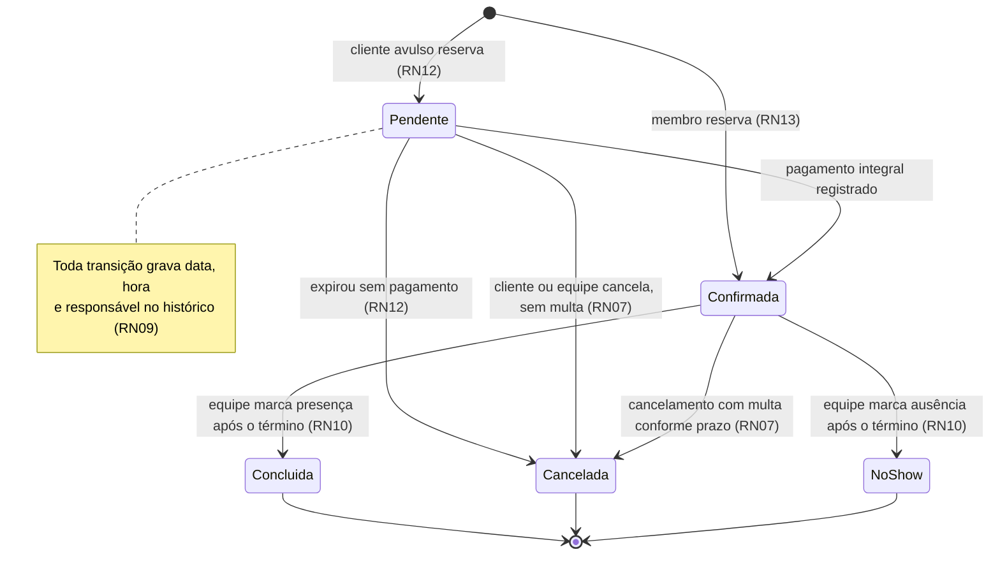

---

## F01 — Cadastro e login (US4, RN14, RN17, FR-001, FR-002, FR-019)

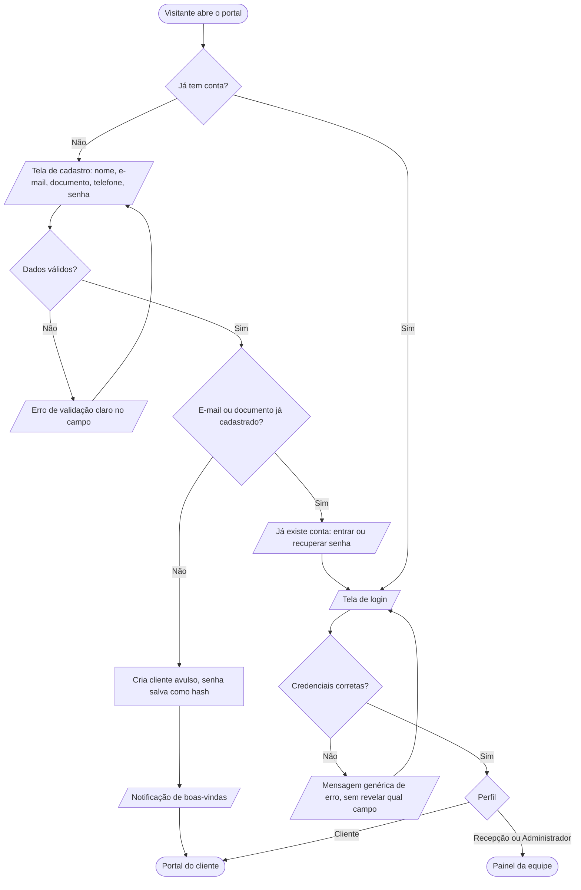

---

## F02 — Consultar disponibilidade e preço (US1, RN01, RN02, RN06, FR-003)

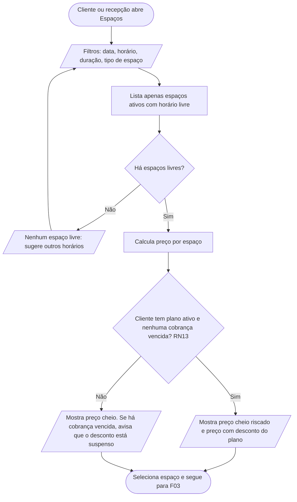

---

## F03 — Criar reserva (US1, RN01 a RN06, RN12, RN13, FR-004, FR-005)

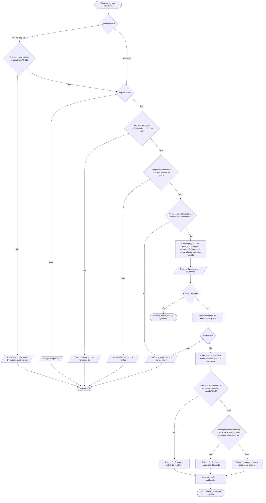

---

## F04 — Pagar e confirmar reserva, registro manual (US2, RN11, RN12, FR-009)

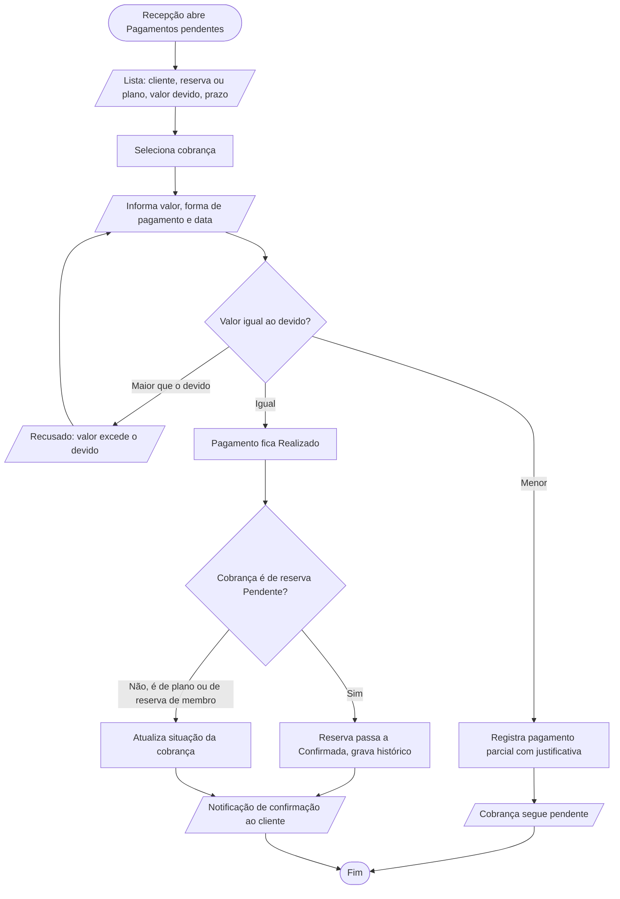

---

## F05 — Cancelar reserva com multa e estorno (US3, RN07, RN08, RN11, FR-007)

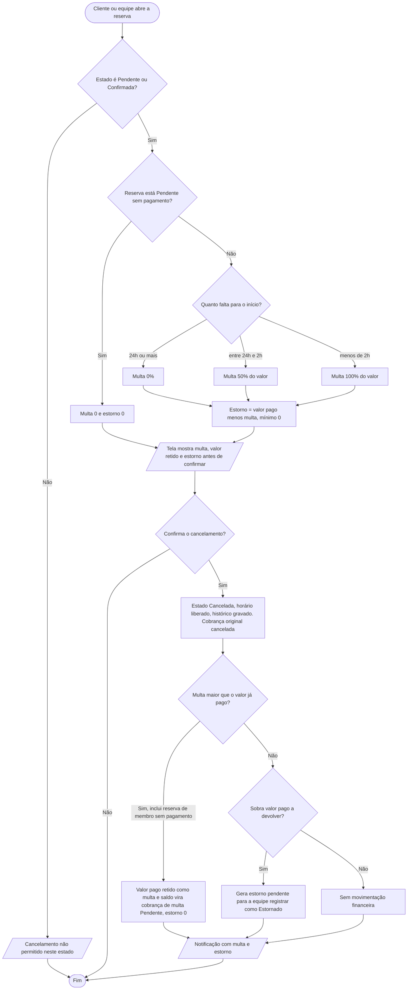

---

## F06 — Encerrar reserva: concluída ou no-show (US2, RN08, RN10, FR-010)

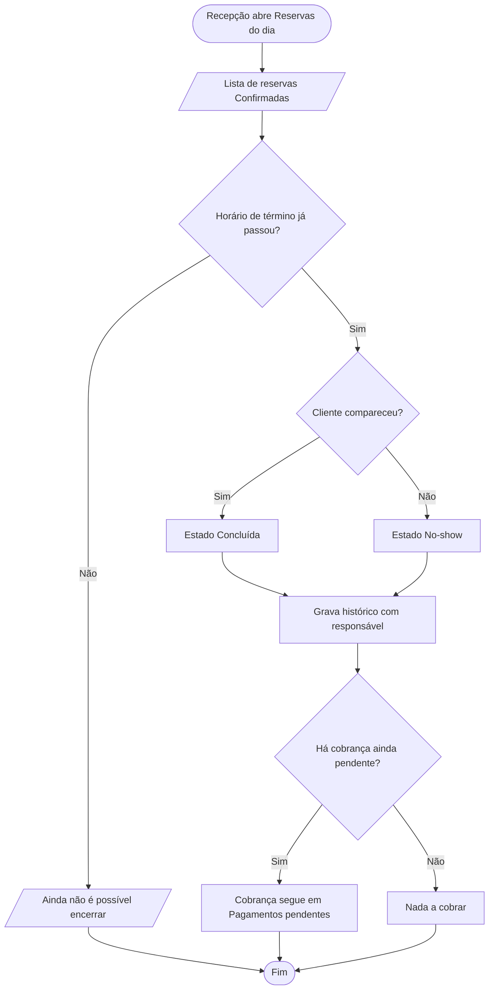

Expiração automática de reservas pendentes (RN12):

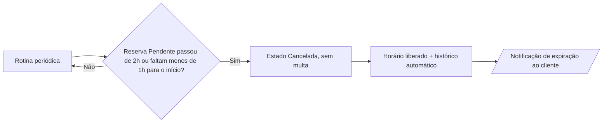

---

## F07 — Gerir espaços, preços e horários (US5, RN01, RN04, RN05, RN15, FR-012)

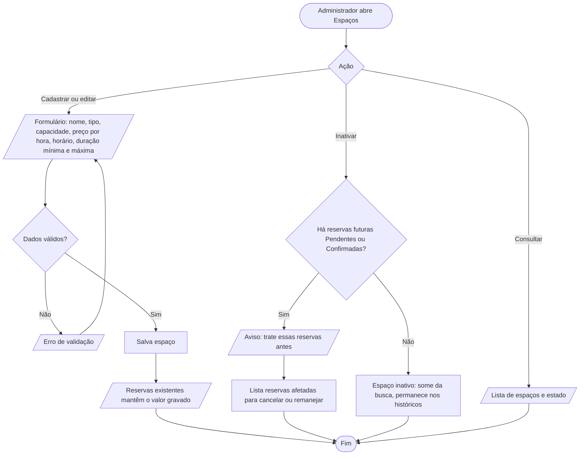

---

## F08 — Gerir planos e assinatura (US5, US6, RN13, RN16, FR-013)

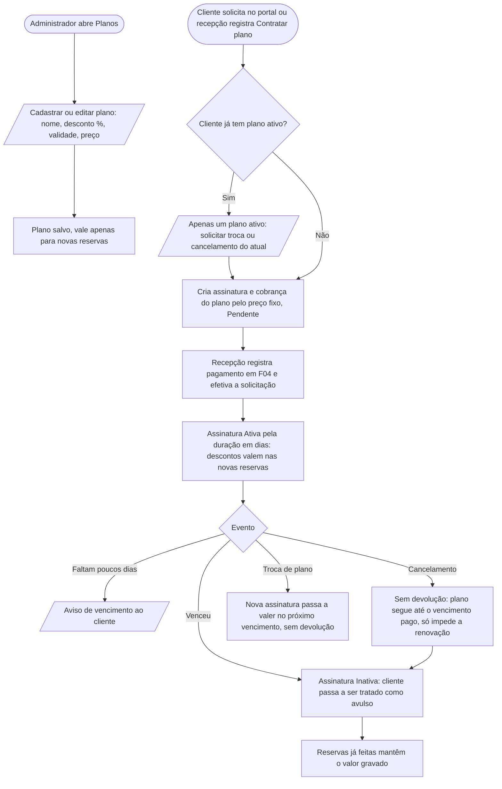

---

## F09 — Gerir clientes (US4, RN14, RN15, RN17, FR-014)

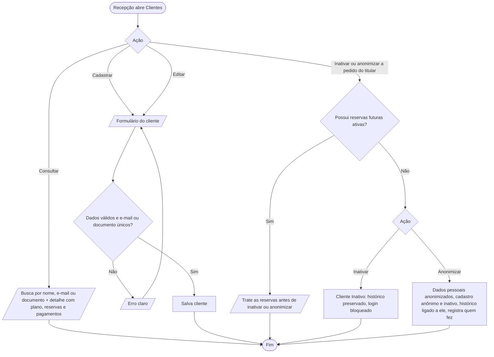

---

## F10 — Notificações recebidas (US7, RN16, FR-015)

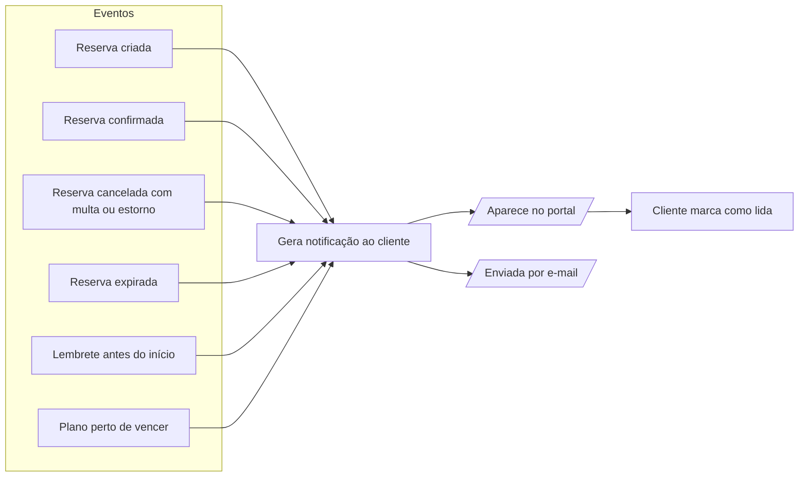

---

## F11 — Relatórios (US7, RN18, FR-016)

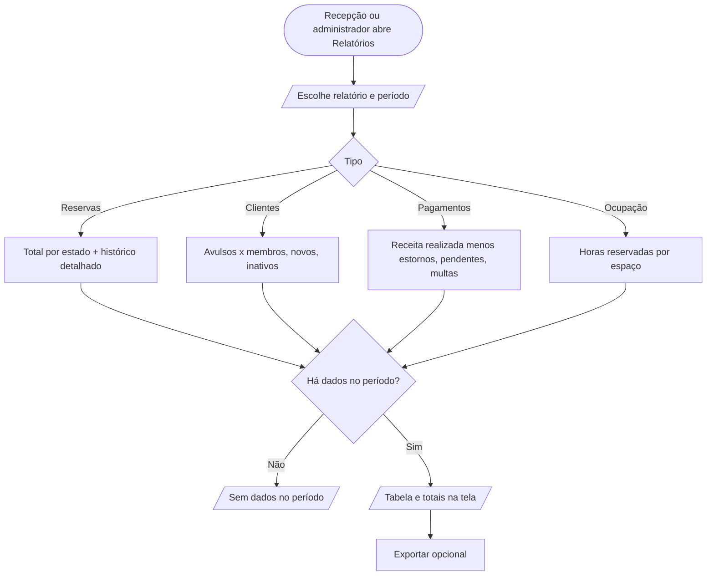

---

## F12 — Gerir usuários da equipe e permissões (RN17, FR-017)

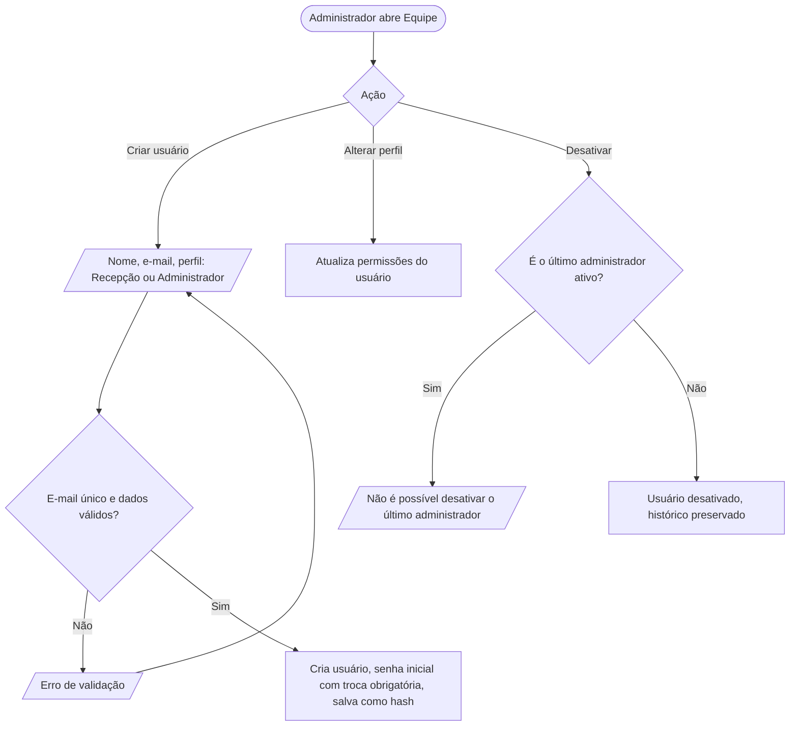

Matriz de permissões (RN17):

| Ação | Cliente | Recepção | Administrador |
|------|:-------:|:--------:|:-------------:|
| Ver e reservar em seu nome | ✔ | ✔ (para qualquer cliente) | ✔ |
| Ver dados de outros clientes | ✘ | ✔ | ✔ |
| Cancelar a própria reserva | ✔ | ✔ (de qualquer cliente) | ✔ |
| Solicitar contratação, troca ou cancelamento de plano | ✔ (só o próprio) | ✔ (efetiva) | ✔ (efetiva) |
| Registrar pagamento e estorno | ✘ | ✔ | ✔ |
| Encerrar reserva (concluída ou no-show) | ✘ | ✔ | ✔ |
| Cadastrar, editar e inativar clientes | ✘ | ✔ | ✔ |
| Gerir espaços, preços e planos | ✘ | ✘ | ✔ |
| Gerir usuários da equipe | ✘ | ✘ | ✔ |
| Relatórios | ✘ | ✔ | ✔ |
